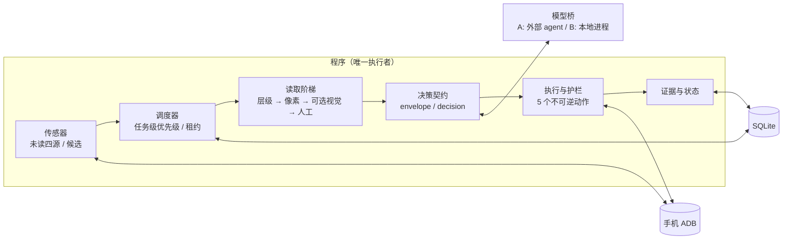
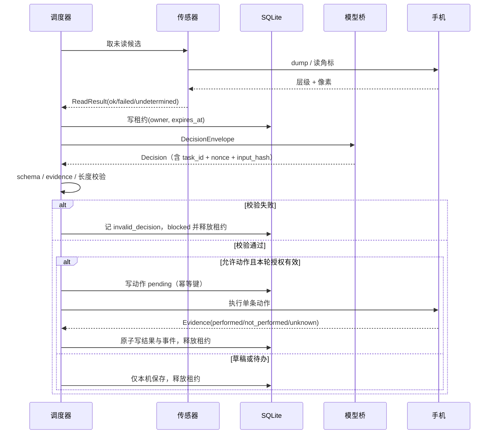
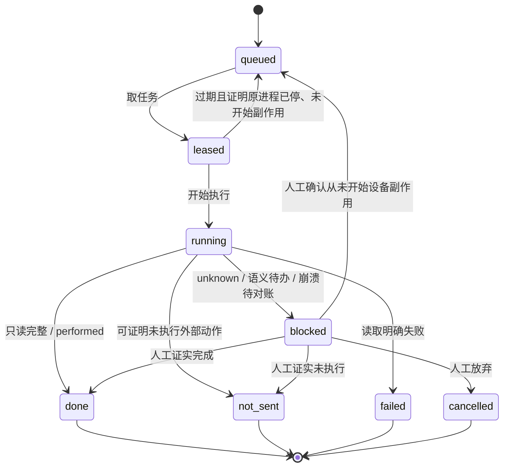
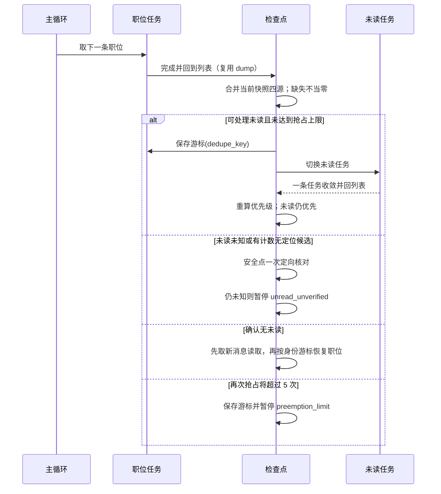
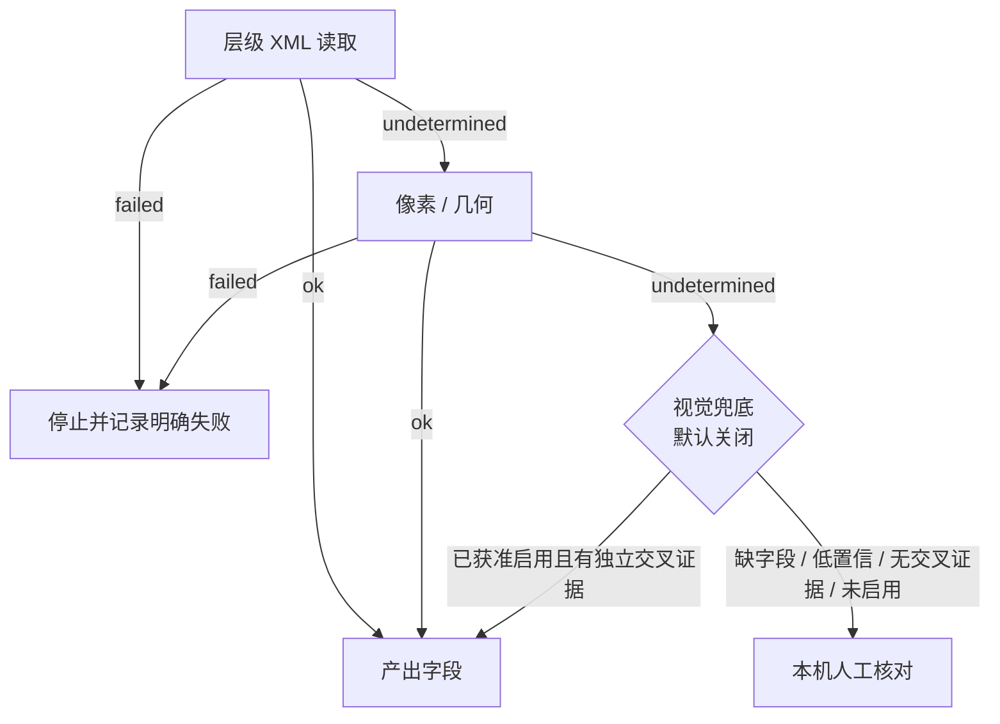
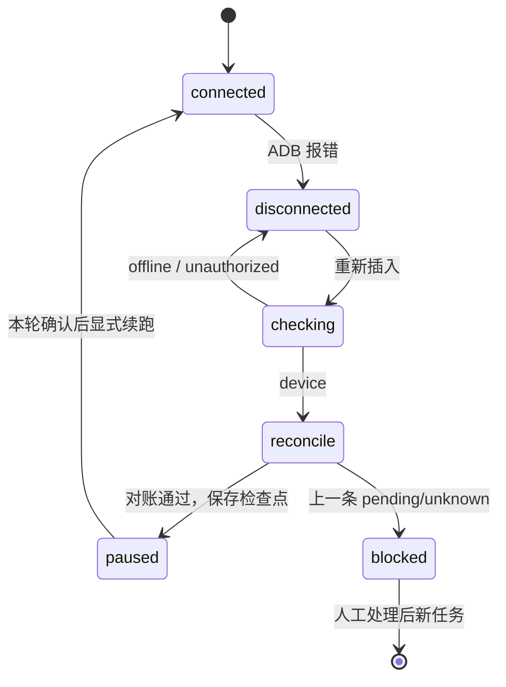

# BOSS直聘求职自动化 实施计划

> 文件用途：把《BOSS直聘_求职自动化_简化架构设计说明》落成可执行的阶段计划，给出里程碑、交付物、验收方式、依赖、风险与发布回滚策略，并用图说明组件、时序、状态机与抢占。本文是计划，不代表对应代码已存在；涉及真实设备的步骤仍需当轮确认。

## 0 范围

- 依据：[`BOSS直聘_求职自动化_简化架构设计说明_20261123.md`](BOSS直聘_求职自动化_简化架构设计说明_20261123.md)。
- 本期目标（MVP）：单设备、串行、有界轮次；未读优先；文本回复；职位单条处理；清理规则。
- 本期不做：多设备、并行、无人值守的不可逆批量、默认开启视觉兜底、主 LLM 编排。
- 代码约束：Python ≥3.13、标准库优先；评测沿用现有 Node/promptfoo；模型凭据不进入业务程序。

术语和 v1 字段以设计说明 §5–6 为准：`ReadResult` 是读取三态，`Evidence` 是动作结果，`DecisionEnvelope` 是单次模型请求；安全点是现场已收敛且检查点已提交的时刻，抢占点是安全点上的任务切换机会。本文命令、文件与测试名均是未来交付约定，当前文档审核不执行它们、不创建这些代码目录。

## 1 成功标准

| 指标 | 目标 | 来源 |
|---|---|---|
| 未读漏检率 | 0 | 设计说明 §10 |
| A 档自动回复率 | ≥ 90% | 同上 |
| `unknown` 率 | < 5% | 同上 |
| 误发/重发 | 0 | 同上 |
| 未读调度等待 | 首次观察后下一个安全点优先处理；正常路径至多一条职位事务，再加检测与切页耗时 | 设计说明 §4.2.6；30 秒是开发基线，不是消息实际到达后的硬保证 |
| 单轮 ADB 调用 | 开发基线 ≤ 200，核实在途结果的超支单列 | 设计说明 §10 |

比率指标的分母、零样本与来源分桶沿用设计说明 §10；M0–M2 只要求下述确定性离线验收通过。开发基线统一为每轮 900 秒/200 次调用/20 条候选、单条职位 30 秒、5 次职位→未读抢占、租约 TTL 60 秒每 20 秒续租；达到限制先核实在途结果再暂停，第 6 次抢占不能继续职位或清理。生产值仍待确认。

## 2 实施策略

1. **先只读、再写入**：先能稳定读屏与判定，再允许点任何按钮。
2. **先草稿、再发送**：A 档自动发送最后开，默认草稿。
3. **每个里程碑独立可验收**：不通过不进下一阶段。
4. **契约先行**：`DecisionEnvelope` 与 `Decision` 定稿后再写调度和执行。
5. **每完成一个模块，同步该目录 `AGENTS.md`**（当前仓库尚未创建 `app/`、`prompts/`、`tests/`，实现时再建）。

## 3 架构图

### 3.1 组件



### 3.2 一次 HR 回复的时序



### 3.3 任务状态机



规则：状态集合及条件更新按设计说明 §6；终态不自动回 queued。无设备副作用的语义待办只阻塞该会话；动作 pending/unknown、设备现场未收敛或全局未读无法核实时整轮停止，保存游标。人工放弃任务也不能解除未决动作键锁；需另行对账，不自动重发。

### 3.4 调度与抢占



### 3.5 读取阶梯



### 3.6 断连与重连



## 4 里程碑

### M0 骨架与只读探针

- 交付：`python -m app` 入口、只读 `doctor`、显式配置加载、白名单事件输出；探针只提供设备清单/解锁/前台组件读取，路径按 §5 分层目录创建。
- 默认无设备、无网络：`doctor --fixture <相对文件>` 只读合成输入；真实探针必须显式 `doctor --device --serial <serial>`，并在执行前取得本轮设备操作确认。两个模式互斥，无模式或缺 serial 都在启动子进程前退出 2；不切应用、不 dump 聊天、不截图、不写业务库。
- 最小配置：仅显式 `--config <相对文件>` 才读取；不自动读取根 `config.json`。省略或 `{}` 的规范结果为 `{"schema_version":1,"mode":"read_only"}`；仅接受这两键，版本仅整数 1、mode 仅 read_only，其它键/类型/路径缺失退出 2 并记 `invalid_config`。本轮不修改现有 `config.example.json`，M5 扩展 schema 时另审权限。
- 合成输入固定为 `{devices:[{alias,state}],selected_alias,unlocked,foreground_app}`；alias 是合成逻辑名，state 仅 `device/offline/unauthorized`，unlocked 为 bool 或 null，foreground_app 为 `boss/other/unknown`。输出单个 JSON `{schema_version:1,status,reason_code,device_count,selected_alias,unlocked,foreground_app}`；不输出真实序列号、窗口原文、绝对路径或异常命令参数。
- 验收命令（实现后）：`python -m unittest tests.test_doctor`；`python -m app doctor --fixture tests/fixtures/doctor/ready.json`。后者退出 0，JSON 为 status=ok、reason_code=null、device_count=1、selected_alias=primary、unlocked=true、foreground_app=boss，且不新增业务库。单测另覆盖无设备、多设备未指定、offline、unauthorized、解锁未知、前台未知、非法配置、模式冲突，并断言 fixture 模式启动子进程次数为 0；测试内部断言预期失败退出码，不把这些负例当成验收命令失败。
- 错误出口：无设备 `device_disconnected`、多设备选择不明 `device_ambiguous`、offline `device_offline`、未授权 `device_unauthorized`、解锁未知/锁屏 `device_locked`、前台未知/错误 `wrong_page`，status=failed、退出 2；IO/解析异常不输出原始敏感内容。
- 依赖：Python 3.13；仅真实探针需要 PATH 上的 ADB，离线验收无需安装 ADB。

### M1 状态模型与租约

- 交付：设计说明 §6 的空库 v1、业务行租约与跨应用唯一设备租约、事务事件、单消费者；`store init --db <相对文件>` 不导入旧库，默认 `data/runtime/runtime.sqlite3`。CLI 的 --db 只接受项目内相对路径，解析链接和 `..` 后仍须位于项目内，否则 invalid_input；已存在的库不能覆盖重建。单测使用可注入的临时项目根，自动生成产物保持忽略。
- 验收命令（实现后）：`python -m unittest tests.test_store tests.test_migrations`；`python -m app store init --db data/runtime/m1-acceptance.sqlite3`，后者连续执行两次都退出 0、输出 schema_version=1，第二次不改变业务行。测试用临时合成库，覆盖同一候选两次 claim 只有一次成功、跨应用全局设备互斥、仅 TTL 过期不能抢占、进程存活未知不能恢复、确认停止后的 leased→queued 与 running→blocked、旧 nonce/过期续租拒绝、事件和状态同事务回滚、未知库版本拒绝、迁移失败回滚。
- 依赖：M0。
- 风险：TTL 被误作恢复许可；必须同时验证进程停止及 nonce，并保留未决动作锁。字段、键算法、空值与恢复出口以设计说明 §6 为准。

### M2 传感器（未读四源）

- 交付：纯函数 XML 解析、版本 profile、设计说明 §5.3 的 `ReadResult[UnreadSnapshot]`、四源聚合与候选 upsert；M2 不连手机、不导航、不打开会话、不推进已读基线。像素与实际定向核对到 M3 接入，缺字段保留 unknown。
- 合成夹具位于 `tests/fixtures/sensor/`；manifest 固定 `{profile_path,xml_paths,observed_at,baseline_rows,coverage_proof}`，路径相对 manifest 目录解析并限制在 fixture 目录内。`xml_paths` 是非空字符串数组（viewport 仅一页），`observed_at` 为 UTC 字符串；`baseline_rows` 每项固定 `{conversation_key,preview_hash,time_hint}`（后两项可 null），无基线就是 unknown。期望结果另存 `expected.json`，传感器不得读取答案。
- `coverage_proof` 固定 `{kind,top_proven,bottom_proven}`，kind 仅 `viewport/full_traversal/calibrated_global_zero`，两证明位为 bool；full_traversal 要求两位均真且所有输入页可解析，global_zero 要求 profile 中已验证的全局零信号且实际观测为零，其余降为 viewport。它是合成采集器提供的覆盖元数据，不是期望标签；M3 真实采集器须按端点与页面变化取得相同证据。
- 验收命令（实现后）：`python -m unittest tests.test_sensor tests.test_sensor_store`；`python -m app sense --fixture tests/fixtures/sensor/positive.json --db data/runtime/m2-acceptance.sqlite3`。后者退出 0，输出 `{schema_version:1,result:ReadResult,stop_reason:null}`，其中 result.status=ok、result.value.unread_state=present、有唯一合成候选，重放不增加发现行。全局未读未知或计数为正但无定位行时退出 2，分别置 stop_reason=unread_unverified/needs_targeted_verification；结构完整的 result 仍 status=ok 且 reason_code=null，不能把全局未知塞进 ReadResult 的失败枚举；读取本身失败则保留它的 reason_code。所有情况都不产生设备/模型调用。
- 单测至少分别覆盖：有效行角标；计数正但无定位行；多源正/零冲突；全覆盖全部适用源明确为零；仅视口为零；全部源缺失；部分零部分未知；语义未确认的新招呼；正文/时间数字不算角标；无基线与预览变化；同会话跨来源合并；身份缺失/重复；过期快照；版本未标定；同指纹重复 upsert。正例不能被判 absent；unknown 不冒充检出；未读与 new_message 去重后优先级由纯函数断言。
- stop_reason 的最终判据复用设计说明 §4.2.2：仅预览变化为正且其它未读源未知时也须核对；有可定位明确未读则先处理该目标。sense 用例在解析器之后调用 domain 的 aggregate_unread，传入 StorePort.unresolved_conversations；同指纹已是终态却仍观察到正信号时只报 needs_targeted_verification，不自动重开终态或制造第二条入站。
- 依赖：M1。
- 风险：版本漂移 → 每条判据记录来源与版本。

M0–M2 完成门槛是上述全部命令退出 0、负例断言通过、离线模式设备/网络调用为 0；缺少测试模块不得以“运行 0 项”视为通过。目录结构、类型和恢复条件已有开发基线，不等待生产意图、归档天数、模型桥或真机阈值决策。

M2 最小 profile 字段也作为离线开发契约，均必填且拒绝额外键：`{profile_id,app,version,calibrated,list_id_suffix,row_fields,badge_region,new_greeting,tab_badge,not_applicable_sources}`。前三项和 list_id_suffix 为非空字符串、app 仅 boss，calibrated 为 bool；`row_fields` 固定 `{name,company,position,preview,time}`，值为资源 ID 后缀字符串；每项只接受行内唯一节点，缺失/重复使对应字段未知，不拼接猜测。`badge_region` 为相对于行矩形的 `[left,top,right,bottom]` 比例（0–1，正面积）或 null；只在该区域内识别唯一非负整数 TextView，正数为 present、显式 0 为 absent，出现多个则未知；无节点不能自行推出 absent。`new_greeting` 固定 `{label,count_id_suffix,semantics_verified}`，`tab_badge` 固定 `{label,count_id_suffix,global_zero_verified}`，前两键为非空字符串、最后一键为 bool；计数只取唯一标签容器中的匹配后缀节点，允许十进制数字或尾部 `+`（此时仅表示下界、非精确数，0+ 保持 unknown），缺失/多节点为未知。未确认语义时正计数仍保守为 present，但零为 unknown。`not_applicable_sources` 为四源名的去重数组，必须附有 profile 对该版本的已验证依据说明（放同目录指南）；不能用它屏蔽未标定字段。合成 profile 的“已验证”仅对合成布局与断言成立，真实 profile 不自动继承。`calibrated=false` 时整体为 undetermined/uncalibrated_profile；非法 profile/manifest 返回 failed/invalid_fixture，且不创建业务行。sense 每次生成一个 snapshot_id，fixture 默认时钟注入为 observed_at，过期测试单独推进时钟；多页由用例按此 ID 聚合去重，每页解析签名见扩展说明 §5.1。

### M3 读取阶梯（第 1、2 级）

- 交付：层级解析、像素判读、人工出口；视觉兜底默认关闭。
- 验收：夹具 + 真机只读一轮；`undetermined` 不会进入决策。
- 依赖：M2。
- 风险：像素阈值依赖机型 → 记录标定来源与日期。

### M4 决策契约与桥

- 交付：`DecisionEnvelope` / `Decision` schema、校验器、nonce、超时、输入哈希；桥接方式 A（外部 agent 联调）与 B（本地进程）。
- 验收：保留现有 24 条黄金集与其原判据，用独立契约夹具建立字段映射后再扩展；现有 eval 输出不直接等同于本文 Decision。新增非法输出、过期 nonce、超时三类反例，未知输入不截断或凭模型补全。
- 依赖：M3。
- 风险：模型输出格式漂移 → 严格校验，失败即丢弃。

### M5 不可逆动作护栏

- 交付：发文本、发简历、换微信、换电话、删会话五个动作；`pending → 执行 → 三态`。
- 验收：夹具覆盖“点击前失败=not_sent”“点击后异常=unknown”“unknown 不重试”；真机单条需当轮确认。
- 依赖：M4。
- 风险：重复发送 → 幂等键 + `unknown` 阻断。

### M6 调度与抢占

- 交付：任务级优先级、安全点判定、批次游标、`stage_preempted` 审计。
- 验收：模拟“职位进行中观察到未读”，验证安全点前不切换、下一安全点优先取未读；检测/切页另计，游标按 `dedupe_key` 恢复、`waited_ms` 从首次观察起算；另覆盖角标未知核对失败和第 6 次抢占均暂停，不能继续职位/清理。
- 依赖：M5。
- 风险：抢占点误判 → 必须同时满足设计说明 §4.2.3 的全部安全点条件，不能只确认回列表和无确认框。

### M7 归档与清理

- 交付：候选规则、保护项、身份核验、双阶段删除、删除后核验。
- 验收：夹具覆盖同名同职位、未读保护、草稿保护、未核实动作保护；删除失败不得记成功。
- 依赖：M6。
- 风险：误删 → 保护项优先 + 双重身份核验。

### M8 评测与灰度

- 交付：指标仪表、真机只读 → 草稿 → A 档发送三级开关。
- 验收：设计说明 §10 全部指标达标；每级至少各一次真机验收记录。
- 依赖：M7。
- 风险：真机环境差异 → 保留只读开关，随时回退。

## 5 目录与文件规划（尚未创建）

```text
app/
  __main__.py                  # M0 调用 cli；python -m app
  cli/main.py                  # M0 doctor；M1 store init；M2 sense
  domain/models.py             # M0–M2 ReadResult/UnreadSnapshot/Lease
  domain/scheduler.py          # M2 纯聚合/优先级函数；M6 完整调度
  ports/device.py              # M0 探针输入与设备通道
  ports/store.py               # M1 upsert/claim/start/renew/finish/recover/只读查询
  usecases/doctor.py           # M0 无副作用探针
  usecases/sense.py            # M2 解析结果与发现入库
  adapters/adb/device.py        # M0 仅显式真实探针调用
  adapters/sqlite/schema.py    # M1 空库 schema 与迁移
  adapters/sqlite/repo.py      # M1 事务、设备租约、候选仓储
  adapters/boss/list.py        # M2 XML 与四源解析
  adapters/boss/profiles/      # M2 合成 profile；真实未标定字段为未知
prompts/
  intent-and-reply.md          # M4
  job-evaluate.md              # M4
docs/
  operator.md                 # M0 起补运行与人工核对说明
tests/                        # M0 起 unittest，含 __init__.py
  fixtures/{doctor,sensor}/    # 只含合成数据
```

本规划采用[扩展说明](求职自动化_多应用扩展与分层_设计说明_20261123.md) §3 的分层路径，取代早期平铺方案；后续 decision/bridge/actions 等按该文路径在对应里程碑添加。创建承载真实文件的目录时同步创建 `AGENTS.md` 与只含 `@AGENTS.md` 的 `CLAUDE.md`，包目录按需加 `__init__.py`；不预建猎聘、prompts 或空的运行时目录。`data/runtime/` 是被忽略的自动生成产物，适用根指南的产物豁免。配置契约在 CLI 实现，不另建空 config 模块。

## 6 交互契约（摘要）

- 一次一任务；请求与响应都是单个 JSON；模型不接触 ADB、数据库、队列。
- 响应必须回显 `schema_version/task_id/nonce/input_hash`，逐项校验；完整类型、词表和摘要见设计说明 §5.1–5.2。
- 超时 20 秒；仅能证明尚未提交请求的传输错误重试 1 次，提交后超时不重试；schema/证据失败丢弃并 blocked。
- 审计仅记输入哈希、原因码和耗时；原始模型输出可能含正文，只能在显式启用的本机调试产物中保存，不写公共报告或事件表。
- 接入方式：A 外部 agent（联调）、B 本地桥（生产）；切换不改程序逻辑。

## 7 Skills 结论

- 旧的业务 Skills 不再设计：流程、命令顺序、阈值、失败分支都归程序。
- 保留两份提示词（`prompts/`）与一份操作手册（`docs/operator.md`）。
- 不创建 `skills/`、`.agents/skills/`、`.claude/skills/`；与现有仓库约定一致。
- 仅当选择让 agent 自己跑循环时，才需要一份“如何调用 CLI 与提交决策”的 Skill，且不作为默认形态。

## 8 测试策略

| 层 | 方式 | 覆盖 |
|---|---|---|
| 单元 | Python 标准库 `unittest` | 状态机、四源聚合、schema 校验、幂等 |
| 契约 | 现有 promptfoo 黄金集扩展 | envelope → decision、反例 |
| 离线集成 | 合成 XML / 合成 DB | 页面识别、动作三态、清理保护 |
| 真机只读 | 每阶段一次 | 页面信号、角标、身份 |
| 真机写入 | 逐条确认 | 发送、请求、删除 |

真机写入不得在自动化测试中默认开启。

## 9 风险与应对

| 风险 | 影响 | 应对 |
|---|---|---|
| 选择器漂移 | 读不到/误判 | 多源 + fail-closed + 记录版本 |
| 未读静默漏读 | 业务直接损失 | 四源交叉，任一为“有”即不报无 |
| 重复发送 | 不可撤回 | 幂等键 + `unknown` 不重试 |
| 上下文污染 | 判断漂移 | 无状态单次调用 + 事实带来源 |
| 截图外发 | 隐私 | 视觉默认关，必要时脱敏或本机模型 |
| USB 断连 | 状态不明 | 分阶段收敛 + 重连对账 |
| 成本/延迟 | 轮次超时 | 预算上限 + 一次一任务决策，不引入跨会话批量提示词 |

## 10 发布与回滚

- 三级开关：`read_only` → `draft_only` → `auto_send_tier_a`，默认最低级。
- 每级开启前跑一次真机验收并记录证据。
- 回滚只需关闭开关，不依赖代码回退；数据结构保留。
- 出现误发或 `unknown` 激增时立即降到 `read_only`。

## 11 待确认

1. A/B 档意图归属与首条回复固定声明。
2. 清理“过期”天数与最后活动口径。
3. 桥接方式选 A 还是 B；生产是否允许外部进程持有凭据。
4. 预算数值（未读条数、单条职位超时、单轮耗时）。
5. 是否启用视觉兜底及其隐私边界。
6. 抢占检查频率（每条职位 vs 每条子步骤）。

以上为生产启用前的待确认项；M0–M2 按设计说明 §5–6、§10 的离线基线开工，固定未读 > 新消息读取 > 职位 > 归档、视觉关闭、只读、禁止自动重连续跑。意图未确认则 C 档待办、归档天数未设则禁用，不把旧项目策略或本计划当作授权。
