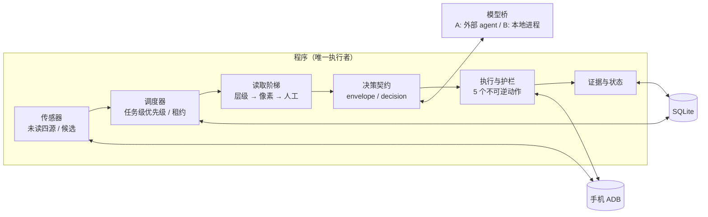
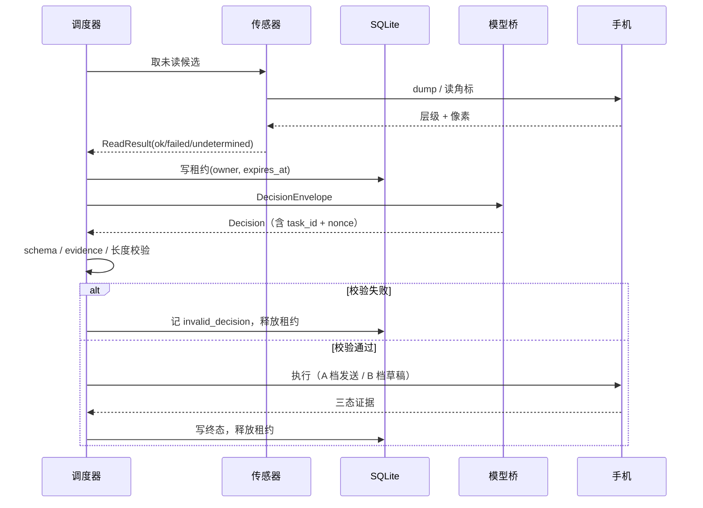
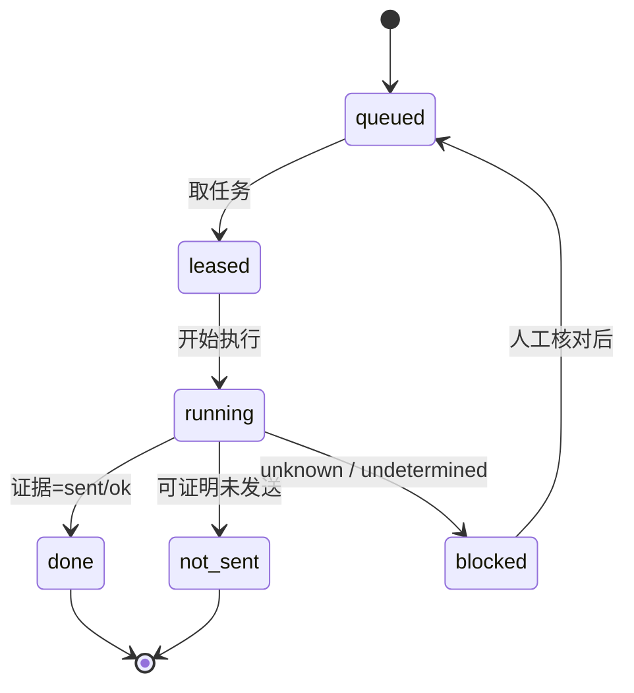
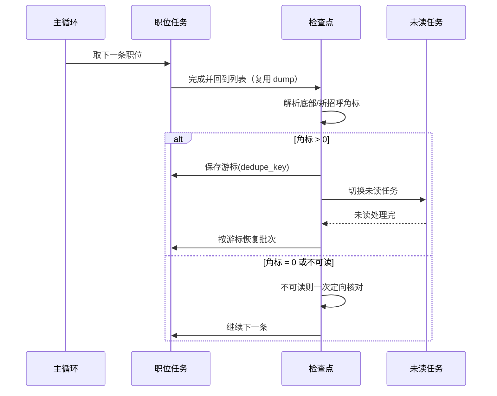
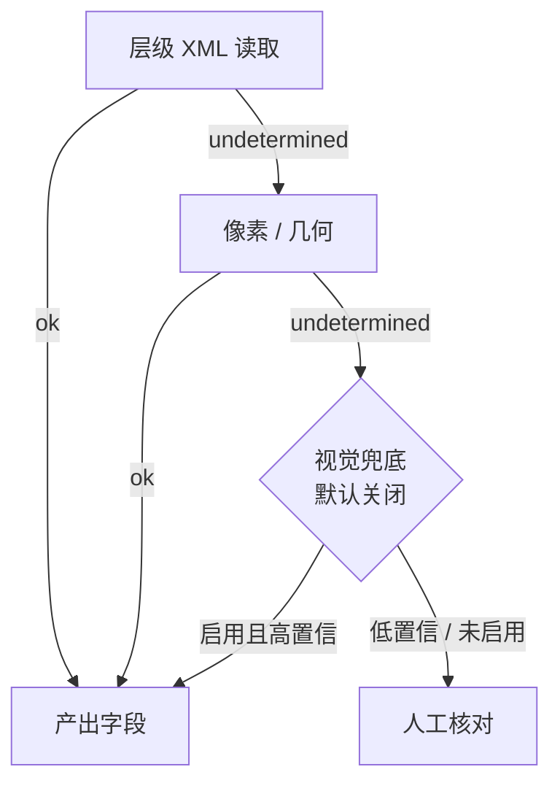
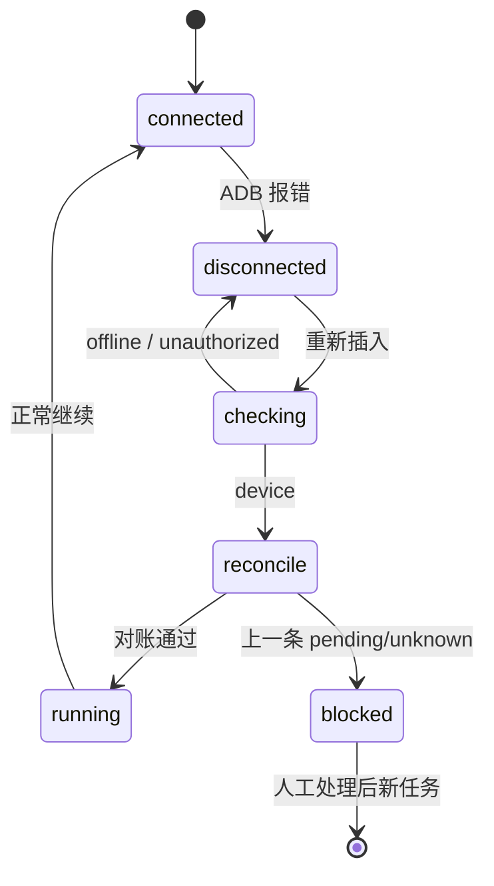

# BOSS直聘求职自动化 实施计划

> 文件用途：把《BOSS直聘_求职自动化_简化架构设计说明》落成可执行的阶段计划，给出里程碑、交付物、验收方式、依赖、风险与发布回滚策略，并用图说明组件、时序、状态机与抢占。本文是计划，不代表对应代码已存在；涉及真实设备的步骤仍需当轮确认。

## 0 范围

- 依据：[`BOSS直聘_求职自动化_简化架构设计说明_20261123.md`](BOSS直聘_求职自动化_简化架构设计说明_20261123.md)。
- 本期目标（MVP）：单设备、串行、有界轮次；未读优先；文本回复；职位单条处理；清理规则。
- 本期不做：多设备、并行、无人值守的不可逆批量、默认开启视觉兜底、主 LLM 编排。
- 代码约束：Python ≥3.13、标准库优先；评测沿用现有 Node/promptfoo；模型凭据不进入业务程序。

## 1 成功标准

| 指标 | 目标 | 来源 |
|---|---|---|
| 未读漏检率 | 0 | 设计说明 §10 |
| A 档自动回复率 | ≥ 90% | 同上 |
| `unknown` 率 | < 5% | 同上 |
| 误发/重发 | 0 | 同上 |
| 未读最大等待 | ≤ 1 条职位事务（≤30 秒） | 设计说明 §4.2.6 |
| 单轮 ADB 调用 | ≤ 200 | 设计说明 §10 |

## 2 实施策略

1. **先只读、再写入**：先能稳定读屏与判定，再允许点任何按钮。
2. **先草稿、再发送**：A 档自动发送最后开，默认草稿。
3. **每个里程碑独立可验收**：不通过不进下一阶段。
4. **契约先行**：`DecisionEnvelope` 与 `Decision` 定稿后再写调度和执行。
5. **每完成一个模块，同步该目录 `AGENTS.md`**（当前仓库尚未创建 `app/`、`prompts/`、`tests/`，实现时再建）。

## 3 架构图

### 3.1 组件



### 3.2 一次 HR 回复的时序



### 3.3 任务状态机



规则：`blocked` 只阻塞该会话；未读状态不可判定时整轮停止。

### 3.4 调度与抢占



### 3.5 读取阶梯



### 3.6 断连与重连



## 4 里程碑

### M0 骨架与只读探针

- 交付：CLI 骨架、配置加载、日志、设备探针（设备清单、解锁、前台组件）。
- 验收：`app doctor` 只读输出设备状态；不写业务表、不点击。
- 依赖：ADB、Python 3.13。
- 风险：多设备选择错误 → 强制显式 `--serial`。

### M1 状态模型与租约

- 交付：业务表租约列、任务状态、事件表；单进程消费者。
- 验收：单测覆盖“重复取任务”“过期抢占”“旧 nonce 拒绝”。
- 依赖：M0。
- 风险：与业务表耦合 → 先写清状态字段与迁移。

### M2 传感器（未读四源）

- 交付：行内数字文本、新招呼计数、底部角标、预览基线四源聚合；`undetermined` 触发暂停。
- 验收：合成 XML 夹具覆盖“有/无/未知/多源冲突”四类；冲突时不得报无。
- 依赖：M1。
- 风险：版本漂移 → 每条判据记录来源与版本。

### M3 读取阶梯（第 1、2 级）

- 交付：层级解析、像素判读、人工出口；视觉兜底默认关闭。
- 验收：夹具 + 真机只读一轮；`undetermined` 不会进入决策。
- 依赖：M2。
- 风险：像素阈值依赖机型 → 记录标定来源与日期。

### M4 决策契约与桥

- 交付：`DecisionEnvelope` / `Decision` schema、校验器、nonce、超时、输入哈希；桥接方式 A（外部 agent 联调）与 B（本地进程）。
- 验收：现有 24 条黄金集迁移到契约级；新增非法输出、过期 nonce、超时三类反例。
- 依赖：M3。
- 风险：模型输出格式漂移 → 严格校验，失败即丢弃。

### M5 不可逆动作护栏

- 交付：发文本、发简历、换微信、换电话、删会话五个动作；`pending → 执行 → 三态`。
- 验收：夹具覆盖“点击前失败=not_sent”“点击后异常=unknown”“unknown 不重试”；真机单条需当轮确认。
- 依赖：M4。
- 风险：重复发送 → 幂等键 + `unknown` 阻断。

### M6 调度与抢占

- 交付：任务级优先级、安全点判定、批次游标、`stage_preempted` 审计。
- 验收：模拟“职位进行中来未读”，验证最多等一条职位、游标按 `dedupe_key` 恢复、`waited_ms` 入库。
- 依赖：M5。
- 风险：抢占点误判 → 只允许在回列表且无确认框时切换。

### M7 归档与清理

- 交付：候选规则、保护项、身份核验、双阶段删除、删除后核验。
- 验收：夹具覆盖同名同职位、未读保护、草稿保护、未核实动作保护；删除失败不得记成功。
- 依赖：M6。
- 风险：误删 → 保护项优先 + 双重身份核验。

### M8 评测与灰度

- 交付：指标仪表、真机只读 → 草稿 → A 档发送三级开关。
- 验收：设计说明 §10 全部指标达标；每级至少各一次真机验收记录。
- 依赖：M7。
- 风险：真机环境差异 → 保留只读开关，随时回退。

## 5 目录与文件规划（尚未创建）

```text
app/
  __main__.py      # CLI 入口与子命令
  db.py            # 连接、迁移、租约
  sensor.py        # 四源未读与候选
  reader.py        # 读取阶梯与三态
  decision.py      # envelope/decision 校验
  bridge.py        # 模型桥（A/B）
  actions.py       # 五个护栏动作
  scheduler.py     # 优先级与抢占
  archive.py       # 清理
prompts/
  intent-and-reply.md
  job-evaluate.md
docs/
  operator.md      # 人怎么运行、看待办、核对 unknown
tests/             # 合成夹具与单测
```

创建这些目录时必须同步创建对应 `AGENTS.md` 与 `CLAUDE.md`；当前仓库不预建空目录。

## 6 交互契约（摘要）

- 一次一任务；请求与响应都是单个 JSON；模型不接触 ADB、数据库、队列。
- 响应必须回显 `task_id` 与 `nonce`；不匹配即拒绝。
- 超时 20 秒；仅传输错误重试 1 次；schema/证据失败直接丢弃。
- 记录输入哈希、原始输出、耗时，供归因。
- 接入方式：A 外部 agent（联调）、B 本地桥（生产）；切换不改程序逻辑。

## 7 Skills 结论

- 旧的业务 Skills 不再设计：流程、命令顺序、阈值、失败分支都归程序。
- 保留两份提示词（`prompts/`）与一份操作手册（`docs/operator.md`）。
- 不创建 `skills/`、`.agents/skills/`、`.claude/skills/`；与现有仓库约定一致。
- 仅当选择让 agent 自己跑循环时，才需要一份“如何调用 CLI 与提交决策”的 Skill，且不作为默认形态。

## 8 测试策略

| 层 | 方式 | 覆盖 |
|---|---|---|
| 单元 | Python 标准库 `unittest` | 状态机、四源聚合、schema 校验、幂等 |
| 契约 | 现有 promptfoo 黄金集扩展 | envelope → decision、反例 |
| 离线集成 | 合成 XML / 合成 DB | 页面识别、动作三态、清理保护 |
| 真机只读 | 每阶段一次 | 页面信号、角标、身份 |
| 真机写入 | 逐条确认 | 发送、请求、删除 |

真机写入不得在自动化测试中默认开启。

## 9 风险与应对

| 风险 | 影响 | 应对 |
|---|---|---|
| 选择器漂移 | 读不到/误判 | 多源 + fail-closed + 记录版本 |
| 未读静默漏读 | 业务直接损失 | 四源交叉，任一为“有”即不报无 |
| 重复发送 | 不可撤回 | 幂等键 + `unknown` 不重试 |
| 上下文污染 | 判断漂移 | 无状态单次调用 + 事实带来源 |
| 截图外发 | 隐私 | 视觉默认关，必要时脱敏或本机模型 |
| USB 断连 | 状态不明 | 分阶段收敛 + 重连对账 |
| 成本/延迟 | 轮次超时 | 预算上限 + 批量分类 |

## 10 发布与回滚

- 三级开关：`read_only` → `draft_only` → `auto_send_tier_a`，默认最低级。
- 每级开启前跑一次真机验收并记录证据。
- 回滚只需关闭开关，不依赖代码回退；数据结构保留。
- 出现误发或 `unknown` 激增时立即降到 `read_only`。

## 11 待确认

1. A/B 档意图归属与首条回复固定声明。
2. 清理“过期”天数与最后活动口径。
3. 桥接方式选 A 还是 B；生产是否允许外部进程持有凭据。
4. 预算数值（未读条数、单条职位超时、单轮耗时）。
5. 是否启用视觉兜底及其隐私边界。
6. 抢占检查频率（每条职位 vs 每条子步骤）。
