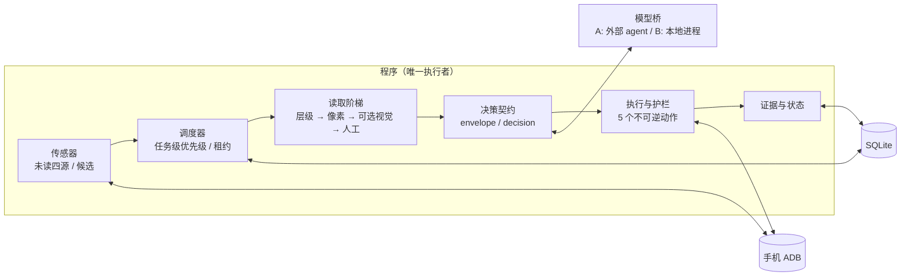
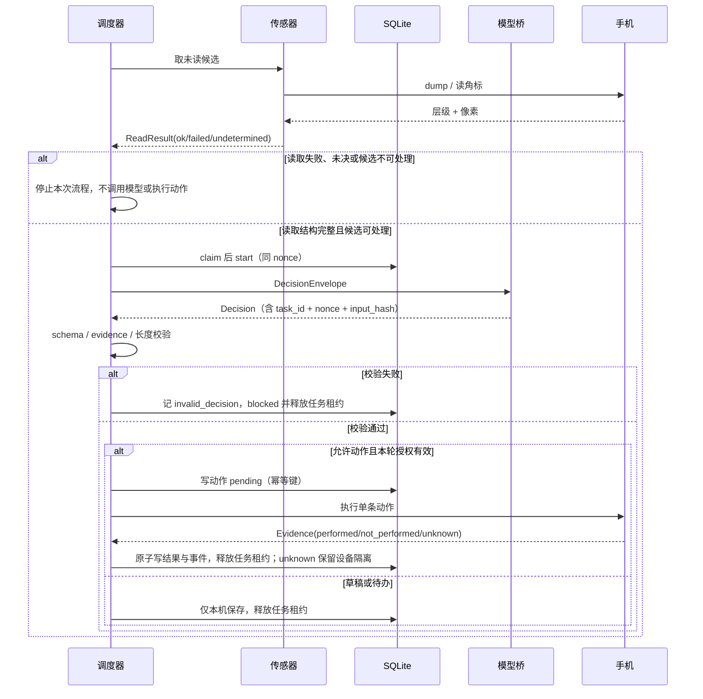
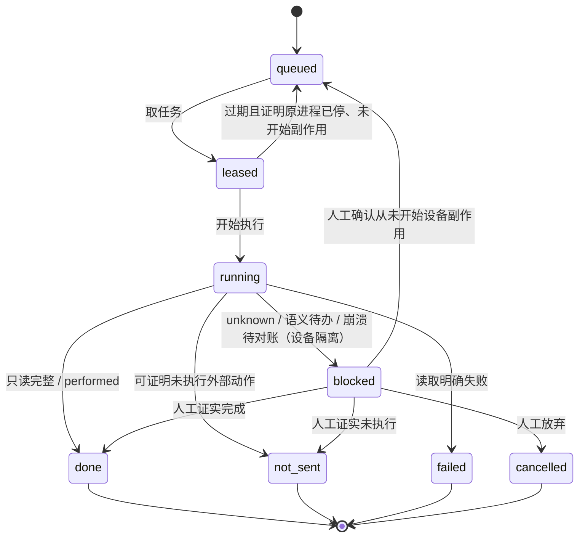
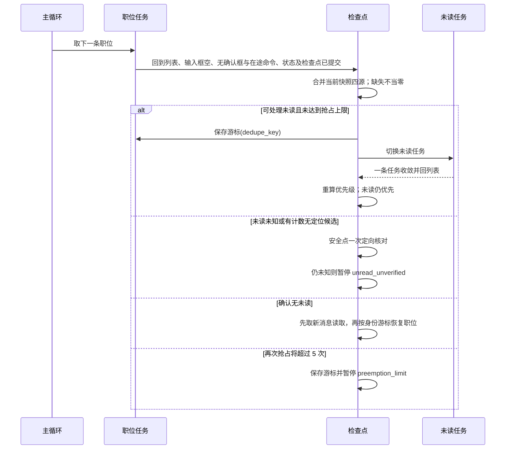
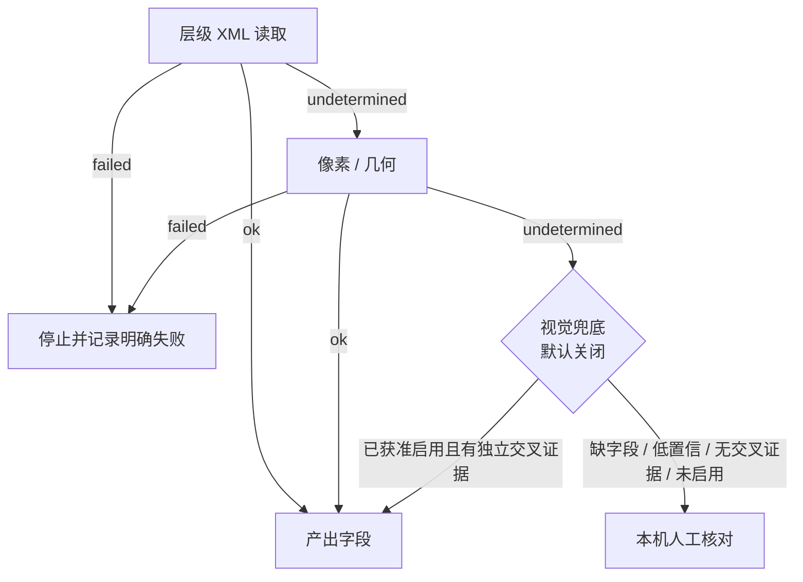
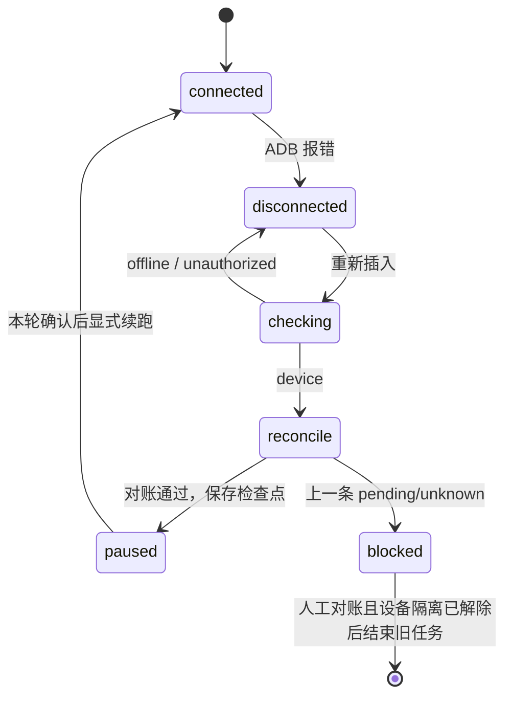

# BOSS直聘求职自动化 实施计划

> 文件用途：把《BOSS直聘_求职自动化_简化架构设计说明》落成可执行的阶段计划，给出里程碑、交付物、验收方式、依赖、风险与发布回滚策略，并用图说明组件、时序、状态机与抢占。本文是计划，不代表对应代码已存在；涉及真实设备的步骤仍需当轮确认。

## 0 范围

- 依据：[`BOSS直聘_求职自动化_简化架构设计说明_20261123.md`](BOSS直聘_求职自动化_简化架构设计说明_20261123.md)。
- 本期目标（MVP）：单设备、串行、有界轮次；未读优先；文本回复；职位单条处理；清理规则。
- 本期不做：多设备、并行、无人值守的不可逆批量、默认开启视觉兜底、主 LLM 编排。
- 代码约束：Python ≥3.13、标准库优先；评测沿用现有 Node/promptfoo；模型凭据不进入业务程序。

术语和 v1 字段以设计说明 §5–6 为准：`ReadResult` 是读取三态，`Evidence` 是动作结果，`DecisionEnvelope` 是单次模型请求；安全点是现场已收敛且检查点已提交的时刻，抢占点是安全点上的任务切换机会。本文命令、文件与测试名均是未来交付约定，当前文档审核不执行它们、不创建这些代码目录。

## 1 成功标准

| 指标 | 目标 | 来源 |
|---|---|---|
| 未读漏检率 | 0 | 设计说明 §10 |
| A 档自动回复率 | ≥ 90% | 同上 |
| `unknown` 率 | < 5% | 同上 |
| 误发/重发 | 0 | 同上 |
| 未读调度等待 | 首次观察后下一个安全点优先处理；正常路径至多一条职位事务，再加检测与切页耗时 | 设计说明 §4.2.6；30 秒是开发基线，不是消息实际到达后的硬保证 |
| 单轮 ADB 调用 | 开发基线 ≤ 200，核实在途结果的超支单列 | 设计说明 §10 |

比率指标的分母、零样本与来源分桶沿用设计说明 §10；M0–M2 只要求下述确定性离线验收通过。开发基线统一为每轮 900 秒/200 次调用/20 条候选、单条职位 30 秒、5 次职位→未读抢占、租约 TTL 60 秒每 20 秒续租；达到限制先核实在途结果再暂停，第 6 次抢占不能继续职位或清理。生产值仍待确认。

## 2 实施策略

1. **先只读、再写入**：先能稳定读屏与判定，再允许点任何按钮。
2. **先草稿、再发送**：M0–M2 默认只读；后续进入决策阶段先出草稿，A 档自动发送最后开。
3. **每个里程碑独立可验收**：不通过不进下一阶段。
4. **契约先行**：`DecisionEnvelope` 与 `Decision` 定稿后再写调度和执行。
5. **每完成一个模块，同步该目录 `AGENTS.md`**（当前仓库尚未创建 `app/`、`prompts/`、`tests/`，实现时再建）。

## 3 架构图

### 3.1 组件



### 3.2 一次 HR 回复的时序



### 3.3 任务状态机



规则：状态集合及条件更新按设计说明 §6；终态不自动回 queued。无设备副作用的语义待办只阻塞该会话；动作 pending/unknown、设备现场未收敛或全局未读无法核实时整轮停止，保存游标。finish 及 running 的过期 recover 进入 blocked 时，统一引用[设计说明 §6](BOSS直聘_求职自动化_简化架构设计说明_20261123.md#6-数据模型) StorePort 第 3 项“blocked 的设备行处置”；父进程停止不证明设备子命令停止，M0–M2 仅测隔离，不提供解除命令。人工放弃任务也不能解除未决动作键锁或设备隔离；需另行对账，不自动重发。

### 3.4 调度与抢占



### 3.5 读取阶梯



### 3.6 断连与重连



## 4 里程碑

本节所有 Python 命令、测试模块和夹具均为实现后的验收契约，当前尚不存在，文档复审不执行它们；当前可执行的 npm 自检不替代这些未来验收。以下命令从项目根执行。CLI 全局 `--config` 放在子命令前；doctor 的 --fixture 与 --device 互斥且必须选其一，--serial 仅允许与 --device 同用且此时必填，sense 必须 --fixture，store 必须 init；不认识的选项、重复选项和缺参数统一退出 2。--db 在 store init/sense 后给出，可省略为 data/runtime/runtime.sqlite3。

CLI 成功或业务停止只向 stdout 写一个 UTF-8 JSON 对象，stderr 不回显输入或异常；帮助退出 0，参数/配置/IO/业务失败退出 2，不用退出 1 表示可重试。参数/配置/仓储错误统一输出 `{schema_version:1,status:'failed',reason_code:<固定原因码>}`，原因只取 invalid_input/invalid_config/invalid_fixture 或设计说明 §6 的仓储词表；doctor 已解析输入后的业务失败用其完整输出，sense 已构造 ReadResult 后用其完整输出。JSON 的所有键必填、拒绝额外键，整数不接受 bool。配置文件省略与文件内容 {} 都取只读默认；部分配置允许缺键并补默认，显式 null/错误类型拒绝。文件读取失败按所属输入分别 invalid_config/invalid_fixture，错误不打印绝对路径。

### M0 骨架与只读探针

- 交付：`python -m app` 入口、只读 `doctor`、显式配置加载、白名单事件输出；探针只提供设备清单/解锁/前台组件读取，路径按 §5 分层目录创建。
- 默认无设备、无网络：`doctor --fixture <相对文件>` 只读合成输入；真实探针必须显式 `doctor --device --serial <serial>`，并在执行前取得本轮设备操作确认。两个模式互斥，无模式或缺 serial 都在启动子进程前退出 2；不切应用、不 dump 聊天、不截图、不写业务库。
- 最小配置：仅显式 `--config <相对文件>` 才读取；不自动读取根 `config.json`。省略或 `{}` 的规范结果为 `{"schema_version":1,"mode":"read_only"}`；仅接受这两键，版本仅整数 1、mode 仅 read_only，其它键/类型/路径缺失退出 2 并记 `invalid_config`。当前 `config.example.json` 只有未来 M4 的 policy_pack 路径引用，不是 M0 可消费的最小配置，不应传给 doctor/sense；M4 才扩展策略加载，M5 的动作权限另审。
- 合成输入固定为 `{devices:[{alias,state}],selected_alias,unlocked,foreground_app}`；alias 是唯一非空合成逻辑名，state 仅 device/offline/unauthorized，selected_alias 为存在的 alias 或 null，unlocked 为 bool 或 null，foreground_app 为 boss/other/unknown。输出单个 JSON `{schema_version:1,status,reason_code,device_count,selected_alias,unlocked,foreground_app}`：版本为整数 1，status 仅 ok/failed，device_count 为清单条数，selected_alias 为所选逻辑名或 null，最后两项类型同输入，reason_code 成功 null、失败取下列词表。只一台且未选择时选该台；零台先报 device_disconnected，多台未选择报 device_ambiguous；选择后按 state、解锁、前台依次判定，失败保留已知字段、未知填 null/unknown。不输出真实序列号、窗口原文、绝对路径或异常命令参数。
- 验收命令（实现后）：`python -m unittest tests.test_doctor`；`python -m app doctor --fixture tests/fixtures/doctor/ready.json`。后者退出 0，JSON 为 status=ok、reason_code=null、device_count=1、selected_alias=primary、unlocked=true、foreground_app=boss，且不新增业务库。单测另覆盖无设备、多设备未指定、offline、unauthorized、解锁未知、前台未知、非法配置、模式冲突，并断言 fixture 模式启动子进程次数为 0；测试内部断言预期失败退出码，不把这些负例当成验收命令失败。
- 错误出口：无设备 `device_disconnected`、多设备选择不明 `device_ambiguous`、offline `device_offline`、未授权 `device_unauthorized`、解锁未知/锁屏 `device_locked`、前台未知/错误 `wrong_page`，status=failed、退出 2；IO/解析异常不输出原始敏感内容。
- ready.json 的完整合成值为 `{"devices":[{"alias":"primary","state":"device"}],"selected_alias":"primary","unlocked":true,"foreground_app":"boss"}`。非法形状、重复 alias、不存在的 selected_alias 或读取失败报 invalid_fixture；fixture 不要求真实设备环境，也不写文件。
- 真实模式仅用 subprocess 参数数组、shell=false，顺序执行 `adb devices`、`adb -s <serial> shell dumpsys window`，每条超时 5 秒且不重试；显式 serial 精确匹配清单，只在内存使用，输出别名 primary。未安装 ADB/子进程超时或非零退出报 device_disconnected，未知清单状态报 device_offline；不在清单报 device_disconnected。窗口输出仅在内存解析：全部 isKeyguardShowing 匹配均为 false 且至少一次才 unlocked=true；全部 true 为 false，缺失/矛盾为 null；mCurrentFocus 唯一有效组件的包名为公开常量 com.hpbr.bosszhipin 才 foreground_app=boss，其它包为 other、缺失/多值为 unknown。此模式只提供一次独立探针，说明最多 10 秒及独占并取得本轮确认后才能执行；M0–M2 无业务设备循环，不把合成业务发现虚构成探针任务。M3 开始前须把真实探针也纳入设备用例的全局占用，未接入时不得与设备循环并用；fixture 永远不启动子进程。
- 依赖：Python 3.13；仅真实探针需要 PATH 上的 ADB，离线验收无需安装 ADB。

### M1 状态模型与租约

- 交付：设计说明 §6 的空库 v1、业务行租约与跨应用唯一设备租约、事务事件、单消费者；`store init --db <相对文件>` 不导入旧库，默认 `data/runtime/runtime.sqlite3`。CLI 的 --db 只接受项目内相对路径，解析链接和 `..` 后仍须位于项目内，否则 invalid_input；已存在的库不能覆盖重建。单测使用可注入的临时项目根，自动生成产物保持忽略。
- 验收命令（实现后）：`python -m unittest tests.test_store tests.test_migrations`；`python -m app store init --db data/runtime/m1-acceptance.sqlite3`，后者连续执行两次都退出 0、完整输出 `{"schema_version":1,"status":"ok","reason_code":null}`，第二次不改变业务行。测试用临时合成库，覆盖同一候选两次 claim 只有一次成功、不同 owner 竞争 primary 全局设备互斥、仅 TTL 过期不能抢占、进程存活未知/权限不足/异主机不能恢复、确认停止后的 leased→queued 与 running→blocked 且设备隔离、旧 nonce/旧截止时间/过期续租/重复 start 和 finish 拒绝、事件和状态同事务回滚、未知/缺索引版本库拒绝、空库初始化中途失败回滚。另分别用 ReadResult.undetermined 与 Evidence.unknown 验证 finish→blocked，按设计说明 §6 StorePort 第 3 项逐字段断言任务租约、设备旧身份与隔离状态；再断言下一次 claim 的 lease_busy 及设备行不变，并分别注入任务更新、设备更新未命中与事件写入失败，验证两表及事件全部回滚。M1 仅 app=boss，不为“跨应用互斥”夹具私自放宽 CHECK；第二应用启用后补跨应用断言。无 1→2 迁移时不虚构生产升级脚本。
- 依赖：M0。
- 风险：TTL 被误作恢复许可；必须同时验证进程停止及 nonce，并保留未决动作锁。字段、键算法、空值与恢复出口以设计说明 §6 为准。

R4 复审：R3 唯一开工阻塞已由[设计说明 §6](BOSS直聘_求职自动化_简化架构设计说明_20261123.md#6-数据模型) StorePort 第 3 项“blocked 的设备行处置”关闭，跨表不变量、第 4 项 recover 及本节断言均引用该契约。判定：PASS；实现 M0–M2 仍需向使用者确认的问题数为 0，其余既定开发基线保持有效。

### M2 传感器（未读四源）

- 交付：纯函数 XML 解析、版本 profile、设计说明 §5.3 的 `ReadResult[UnreadSnapshot]`、四源聚合与候选 upsert；M2 不连手机、不导航、不打开会话、不推进已读基线。像素与实际定向核对到 M3 接入，缺字段保留 unknown。
- 合成夹具位于 tests/fixtures/sensor/；manifest 所有键必填、拒绝额外键，固定 `{profile_path,xml_paths,app_version,observed_at,baseline_rows,coverage_proof}`。profile_path 为非空字符串，xml_paths 是非空去重字符串数组（viewport 仅一页），各路径相对 manifest 目录解析且必须是该 fixture 目录内的现有文件，拒绝绝对路径、越界链接/..；app_version 为非空字符串，必须等于 profile.version，否则 undetermined/uncalibrated_profile；observed_at 为毫秒 UTC 字符串。baseline_rows 为数组，每项固定 `{conversation_key,preview_hash,time_hint}`，key 为含 boss 前缀的非空会话键、后两项为摘要/字符串或 null，重复 key 非法；仅非空 preview_hash 才是可比较基线，无基线就是 unknown。期望结果另存 expected.json，传感器不得读取答案。
- `coverage_proof` 固定 `{kind,top_proven,bottom_proven}`，kind 仅 `viewport/full_traversal/calibrated_global_zero`，两证明位为 bool；full_traversal 要求两位均真且所有输入页可解析，global_zero 要求 profile 中已验证的全局零信号且实际观测为零，其余降为 viewport。它是合成采集器提供的覆盖元数据，不是期望标签；M3 真实采集器须按端点与页面变化取得相同证据。
- 验收命令（实现后）：`python -m unittest tests.test_sensor tests.test_sensor_store`；`python -m app sense --fixture tests/fixtures/sensor/positive.json --db data/runtime/m2-acceptance.sqlite3`。后者退出 0，输出 `{schema_version:1,result:ReadResult,stop_reason:null}`，其中 result.status=ok、result.value.unread_state=present、有唯一合成候选，重放不增加发现行。全局未读未知或计数为正但无定位行时退出 2，分别置 stop_reason=unread_unverified/needs_targeted_verification；结构完整的 result 仍 status=ok 且 reason_code=null，不能把全局未知塞进 ReadResult 的失败枚举；读取本身失败则保留它的 reason_code。所有情况都不产生设备/模型调用。
- 单测至少分别覆盖：有效行角标；计数正但无定位行；多源正/零冲突；全覆盖全部适用源明确为零；仅视口为零；全部源缺失；部分零部分未知；语义未确认的新招呼；正文/时间数字不算角标；无基线与预览变化；同会话跨来源合并；身份缺失/重复；过期快照；版本未标定；同指纹重复 upsert。正例不能被判 absent；unknown 不冒充检出；未读与 new_message 去重后优先级由纯函数断言。
- stop_reason 的最终判据复用设计说明 §4.2.2：仅预览变化为正且其它未读源未知时也须核对；有可定位明确未读则先处理该目标。sense 用例在解析器之后调用 domain 的 aggregate_unread，传入 StorePort.unresolved_conversations；同指纹已是终态却仍观察到正信号时只报 needs_targeted_verification，不自动重开终态或制造第二条入站。
- 依赖：M1。
- 风险：版本漂移 → 每条判据记录来源与版本。

M0–M2 完成门槛是上述全部未来验收命令退出 0、负例断言通过、离线模式设备/网络调用为 0；缺少测试模块不得以“运行 0 项”视为通过。目录结构、类型和恢复条件已有开发基线，不等待生产意图、归档天数、模型桥或真机阈值决策。

M2 最小 profile 字段也作为离线开发契约，均必填且拒绝额外键：`{profile_id,app,version,calibrated,list_id_suffix,row_id_suffix,row_fields,badge_region,new_greeting,tab_badge,not_applicable_sources}`。profile_id/version/list_id_suffix/row_id_suffix 为非空字符串、app 仅 boss，calibrated 为 bool。XML 用标准库 ElementTree 读取，只接受 hierarchy 根和 node 元素，DOCTYPE/ENTITY/其它元素均 failed/invalid_xml；列表由唯一 resource-id 后缀匹配，无匹配为 failed/wrong_page、多匹配为 undetermined/incomplete_snapshot；行由列表内 row_id_suffix 匹配，嵌套行也为 undetermined/incomplete_snapshot，按文档顺序取行。`row_fields` 固定 `{name,company,position,preview,time}`，值为非空资源 ID 后缀字符串；每项只接受行内唯一节点的原样 text，缺失/重复/空身份字段使对应字段未知，不拼接或 strip 猜测。`badge_region` 为相对于行矩形的 `[left,top,right,bottom]` 数字比例（0–1，正面积、拒绝 bool）或 null；行和节点 bounds 必须为四个非负整数且正尺寸，节点矩形完全落在区域内才纳入；只识别 android.widget.TextView 的唯一 ASCII 十进制整数 text，正数为 present、显式 0 为 absent，多个/非法 bounds/无节点为 unknown（原因分别 ambiguous_signal/uncalibrated_region/missing_signal），null 区域为 unknown/uncalibrated_region。

`new_greeting` 固定 `{label,count_id_suffix,semantics_verified}`，`tab_badge` 固定 `{label,count_id_suffix,global_zero_verified}`，前两键为非空字符串、最后一键为 bool；标签按 text 精确匹配且不位于消息行内，标签的直接父节点作为容器，其子树中匹配后缀的计数节点必须唯一。只接受 ASCII 十进制数字或尾部 +：正下界报告 present、count=null（不把下界当精确值），0+ 为 unknown/ambiguous_signal；缺失/多节点为 unknown/missing_signal 或 ambiguous_signal。新招呼 semantics_verified=false 时正值仍保守 present，0 为 unknown/unverified_semantics；底部 tab 的 0 仅 global_zero_verified=true 才 absent，否则 unknown/unverified_semantics。`not_applicable_sources` 为四源名去重数组，须有同目录指南中的已验证依据；显式不适用优先于节点解析，只对该合成版本有效，不能掩盖未标定字段。calibrated=false 或版本不符整体返回 undetermined/uncalibrated_profile；非法 profile/manifest 为 failed/invalid_fixture，不写业务行。XML 格式损坏为 failed/invalid_xml，不用空列表代替。

多页处理固定为：sense 生成同一个 snapshot_id，依序调用 `parse_snapshot(xml_text: str, profile: dict, baseline_rows: list[dict], observed_at: str, snapshot_id: str) → ReadResult[UnreadSnapshot]`；逐页 coverage=viewport，每页初始 unread_state 按可见正信号计算，否则 unknown。任一页非 ok 则整体采用顺序上首个失败/未决页的原因、value=null，不入库。合并纯函数 `merge_snapshots(pages: list[ReadResult], profile: dict, baseline_rows: list[dict], coverage_proof: dict, now: str) → ReadResult[UnreadSnapshot]` 要求非空同 ID/app/profile/时间，baseline_rows 与单页解析使用同一已校验数组，违反为 failed/invalid_fixture；时间距 now 不在 0–5 秒为 undetermined/stale_snapshot。相邻页边界只合并连续、整行字段完全一致的最长重叠段（不在单页内去重）；其余重复身份使这些行的 conversation_key=null、不产生对应候选。全局新招呼/tab 信号各页完全相同才保留，变化或缺失冲突为 unknown/ambiguous_signal、不求和；但任一页明确 present 必须保留 present，计数不一致时 count=null。再用同一 baseline_rows 对合并后的行计算 row_badge、preview_delta、指纹和候选，不按页拼接重复候选。full_traversal 的 top/bottom 两证明位均真且全部页 ok 才 coverage=all；calibrated_global_zero 仅在 tab_badge.global_zero_verified=true 且观测精确 0 时 all；其它降 viewport，再重算源的 absent 条件。默认 fixture 时钟注入 observed_at，过期测试推进 now，不依赖执行当天时间。

sense 在所有输入校验及合并 ok 后才打开/初始化 --db，调用 upsert_snapshot，再查询 unresolved_conversations 并聚合；M2 不 claim/start/finish、不消耗发现。stop_reason 按顺序：存在可领取的 unread 候选则 null；任一行角标/新招呼/tab 正值却无可领取 unread，或正候选全被终态/占用挡住，则 needs_targeted_verification；任一适用的前三源 unknown，或聚合 unknown，则 unread_unverified；仅 preview 正且其它源明确 absent/not_applicable、有可领取 new_message 时 null；聚合 absent 时 null；其它情况 needs_targeted_verification。stop_reason=null 退出 0，其余退出 2；result 非 ok 时 stop_reason=result.reason_code、退出 2 且不写库。仓储错误用公共安全错误对象，不伪造成功的 ReadResult。有未知字段但结构 ok 的可定位正发现可以落库，即使本轮仍须停止。

夹具布局固定为 doctor/ready.json，以及 sensor/positive.json（manifest）、profile.json、positive.xml、expected.json；其它案例用不同 manifest/XML 文件，不让输入引用 expected。positive 的 XML 仅一行合成身份、区域内角标为 1；其它源即使未知也不阻断该明确目标，baseline_rows=[]、coverage_proof={kind:'viewport',top_proven:false,bottom_proven:false}。expected.json 是按 manifest 文件名索引的对象，每项固定 `{exit_code,result_status,unread_state,stop_reason,candidate_kinds,discovery_count}`；exit_code 仅 0/2、result_status 仅 ok/failed/undetermined、unread_state 为 present/absent/unknown 或 null、stop_reason 为上述固定原因或 null、candidate_kinds 为 unread/new_message 数组、discovery_count 为非负整数。positive 的期望为 0/ok/present/null/['unread']/1，重复执行仍为 1；哈希/UUID 不写死，由独立键算法断言，expected 不从被测输出生成。坏输入、未来快照、重叠页、真实重复身份、终态旧键与不同 queued 新键并存、全部不适用、缺基线但全局零等反例也纳入测试；负例退出 2 由单测捕获，验收测试进程本身必须退出 0。

### M3 读取阶梯（第 1、2 级）

- 交付：层级解析、像素判读、人工出口；视觉兜底默认关闭。
- 验收：夹具 + 真机只读一轮；`undetermined` 不会进入决策。
- 依赖：M2。
- 风险：像素阈值依赖机型 → 记录标定来源与日期。

### M4 决策契约与桥

- 交付：`DecisionEnvelope` / `Decision` schema、校验器、nonce、超时、输入哈希；桥接方式 A（外部 agent 联调）与 B（本地进程）；固定 TOML v1 与三份 md、公开 base/纯合成示例；`policy init/validate/preview/eval/list/snapshot/restore`，按[策略包说明](求职自动化_公开仓库与策略包_设计说明_20261123.md) §3–5 的类型、错误、摘要、备份/恢复契约实现。preview 纯渲染，发布独立合成 policy-greeting 输入，不读取黄金答案；eval 实际加载当前包并显式选择获准 provider，不把 smoke 当模型评测。
- 验收：保留现有 24 条黄金集与其原判据，用独立契约夹具建立映射和新断言；现有输出不直接等同于 Decision，不能原样调用 npm 评测就声称测过包。新增非法输出、过期 nonce、超时、注入、摘要变更与逐字段反例。未参与设计者只编辑 md/TOML 完成改语气/分档/披露→validate→preview→eval→snapshot→restore，错误可定位文件/字段/行；拒绝越权、重叠/漏覆盖、越界、链接、事实/联系方式。验证摘要确定性、无自引用、快照恢复中断不留半包、旧草稿/验收失效；docs/operator.md 随交付复用策略包说明 §5。
- 前置限制：策略工具不得连接设备；真实模型外发需本轮确认，私有留出只用获准无上传本机 provider。profile 独立业务库加固定 OS 应用数据位置的共享 SQLite 设备门禁库，是策略包说明 §8 的唯一方案；跨 worktree/clone 先占全局再进 profile，跨库失败保留占用，整个真实 run（含 read_only）结束并收敛现场后才释放，不靠 TTL 解锁。并发、进程崩溃、业务库不可读、换 profile 及旧库拒绝迁移须验收，未交付不接真实 run，不改 M1 已定五表。个人事实交互入口按 §5.2 待选 CLI/本机表单并交付，值不进包。A 档独立前置判据未实现则 policy_tier=C；实现这些工具不自动获得运行/发送授权。策略子命令使用该说明 §5 的固定成功/错误外层，作为本计划 §4 通用错误出口的明确扩展，不能直接打印 TOML 原异常。
- 补充验收：eval 帮助列 provider 格式、认证变量名与安全诊断入口；桥按 system/developer/user JSON 固定边界交付，不支持即拒绝。公开案例仅当前输入进入数据区，答案/metadata/断言不入模型；留出每候选发布新冻结批次，查看并用于调优即整批转回归，三类报告分别计数，缺维护者或本机 provider 记未测。恢复清单/快照/目标 pack_hash 三值一致、同 profile 不重置额度且重新验收，口径以策略包说明 §5–6 为准。
- 依赖：M3。
- 风险：模型输出格式漂移 → 严格校验，失败即丢弃。

P3 终审以策略包说明 §11.3 为准：M4 编辑与验证的设计阻塞数为 0；工具尚未交付与 provider/留出维护等前置列在该文 §12。v1 按固定 C 分支实现，不临场发明 A 前置判据；run 模式及确认统一引用该文 §5，真实运行仍依赖后续里程碑。以后实际启用 A 须先补独立判据设计与反例验收，不能用 M4 完成或本轮 PASS 代替。

### M5 不可逆动作护栏

- 交付：发文本、发简历、换微信、换电话、删会话五个动作；`pending → 执行 → 三态`。
- 验收：夹具覆盖“点击前失败=not_sent”“点击后异常=unknown”“unknown 不重试”；真机单条需当轮确认。
- 依赖：M4。
- 风险：重复发送 → 幂等键 + `unknown` 阻断。

### M6 调度与抢占

- 交付：任务级优先级、安全点判定、批次游标、`stage_preempted` 审计。
- 验收：模拟“职位进行中观察到未读”，验证安全点前不切换、下一安全点优先取未读；检测/切页另计，游标按 `dedupe_key` 恢复、`waited_ms` 从首次观察起算；另覆盖角标未知核对失败和第 6 次抢占均暂停，不能继续职位/清理。
- 依赖：M5。
- 风险：抢占点误判 → 必须同时满足设计说明 §4.2.3 的全部安全点条件，不能只确认回列表和无确认框。

### M7 归档与清理

- 交付：候选规则、保护项、身份核验、双阶段删除、删除后核验。
- 验收：夹具覆盖同名同职位、未读保护、草稿保护、未核实动作保护；删除失败不得记成功。
- 依赖：M6。
- 风险：误删 → 保护项优先 + 双重身份核验。

### M8 评测与灰度

- 交付：指标仪表、真机只读 → 草稿 → A 档发送三级开关。
- 验收：设计说明 §10 全部指标达标；每级至少各一次真机验收记录。
- 依赖：M7。
- 风险：真机环境差异 → 保留只读开关，随时回退。

## 5 目录与文件规划（尚未创建）

```text
app/
  __main__.py                  # M0 调用 cli；python -m app
  cli/main.py                  # M0 doctor；M1 store init；M2 sense
  domain/models.py             # M0–M2 ReadResult/UnreadSnapshot/Lease
  domain/scheduler.py          # M2 纯聚合/优先级函数；M6 完整调度
  ports/device.py              # M0 探针输入与设备通道
  ports/store.py               # M1 upsert/claim/start/renew/finish/recover/只读查询
  usecases/doctor.py           # M0 无副作用探针
  usecases/sense.py            # M2 解析结果与发现入库
  adapters/adb/device.py        # M0 仅显式真实探针调用
  adapters/sqlite/schema.py    # M1 空库 schema 与迁移
  adapters/sqlite/repo.py      # M1 事务、设备租约、候选仓储
  adapters/boss/list.py        # M2 XML 与四源解析
  adapters/boss/profiles/      # M3 起真实设备 profile；与用户策略 profile 区分
  domain/policy.py             # M4 纯校验、分档、摘要与渲染
  ports/policy.py              # M4 本机包加载/快照/恢复端口
  usecases/policy.py           # M4 编辑验证流程与评测编排
  adapters/files/policy.py     # M4 本机文件 IO，不连接设备或远程下载
prompts/
  base/
    intent-and-reply.md        # M4 公开：意图词表、输出契约、安全下限
    job-evaluate.md            # M4 公开：职位评估维度与契约
  examples/default/            # M4 公开：纯合成四文件示例，仅作为 init 来源
  local/                       # 忽略：本机四文件活动包，init 时才产生
    history/                   # 忽略：快照/恢复备份，不作为活动包
evals/
  private/{regression,holdout}/ # 忽略：区分调优回归和未调优留出，不预建
docs/
  operator.md                 # M0 起补运行、策略编辑与人工核对说明
tests/                        # M0 起 unittest，含 __init__.py
  fixtures/{doctor,sensor}/    # M0–M2 只含合成数据
  fixtures/policy-preview/     # M4 独立合成预览输入，不含评测答案
```

本规划采用[扩展说明](求职自动化_多应用扩展与分层_设计说明_20261123.md) §3 的分层路径，取代早期平铺方案；策略包与公开/私有资产边界见[公开仓库与策略包说明](求职自动化_公开仓库与策略包_设计说明_20261123.md)。后续 decision/bridge/actions 等按该文路径在对应里程碑添加。创建承载真实文件的目录时同步创建 `AGENTS.md` 与只含 `@AGENTS.md` 的 `CLAUDE.md`，包目录按需加 `__init__.py`；不预建猎聘、prompts/local 或空的运行时目录。`data/runtime/` 是被忽略的自动生成产物，适用根指南的产物豁免。配置契约在 CLI 实现，不另建空 config 模块。

## 6 交互契约（摘要）

- 一次一任务；请求与响应都是单个 JSON；模型不接触 ADB、数据库、队列。
- 响应必须回显 `schema_version/task_id/nonce/input_hash`，逐项校验；完整类型、词表和摘要见设计说明 §5.1–5.2。
- 超时 20 秒；仅能证明尚未提交请求的传输错误重试 1 次，提交后超时不重试；schema/证据失败丢弃并 blocked。
- 审计仅记输入/来源/模型配置摘要、原因码和耗时；M4 的 base_version/base_hash/pack_id/pack_hash/prompt_hash/rendered_at/provider_id/model_id/model_config_hash 以策略包说明 §4 为准。原始输出与预览可能含私有内容，只能保存到忽略的本机产物，不写公共报告或事件表。
- 接入方式：A 外部 agent（联调）、B 本地桥（生产）；切换不改程序逻辑。

## 7 Skills 结论

- 旧的业务 Skills 不再设计：流程、命令顺序、阈值、失败分支都归程序。
- 保留 `prompts/base` 的提示词契约、`prompts/local` 的本机策略包与 `docs/operator.md` 操作手册；公开/私有边界见[公开仓库与策略包说明](求职自动化_公开仓库与策略包_设计说明_20261123.md)。
- 换人只编辑包中的 md/TOML，初始化/校验/预览/评测/回滚由程序完成；公开示例只作 init 来源，公开黄金集不作 few-shot，私有留出与已用于调优的回归分开统计。
- 不创建 `skills/`、`.agents/skills/`、`.claude/skills/`；与现有仓库约定一致。
- 仅当选择让 agent 自己跑循环时，才需要一份“如何调用 CLI 与提交决策”的 Skill，且不作为默认形态。

## 8 测试策略

| 层 | 方式 | 覆盖 |
|---|---|---|
| 单元 | Python 标准库 `unittest` | 状态机、四源聚合、schema 校验、幂等 |
| 契约 | 现有 promptfoo 黄金集扩展 | envelope → decision、反例 |
| 离线集成 | 合成 XML / 合成 DB | 页面识别、动作三态、清理保护 |
| 真机只读 | 每阶段一次 | 页面信号、角标、身份 |
| 真机写入 | 逐条确认 | 发送、请求、删除 |

真机写入不得在自动化测试中默认开启。

## 9 风险与应对

| 风险 | 影响 | 应对 |
|---|---|---|
| 选择器漂移 | 读不到/误判 | 多源 + fail-closed + 记录版本 |
| 未读静默漏读 | 业务直接损失 | 四源交叉，任一为“有”即不报无 |
| 重复发送 | 不可撤回 | 幂等键 + `unknown` 不重试 |
| 上下文污染 | 判断漂移 | 无状态单次调用 + 事实带来源 |
| 截图外发 | 隐私 | 视觉默认关，必要时脱敏或本机模型 |
| USB 断连 | 状态不明 | 分阶段收敛 + 重连对账 |
| 成本/延迟 | 轮次超时 | 预算上限 + 一次一任务决策，不引入跨会话批量提示词 |

## 10 发布与回滚

- 三级开关：`read_only` → `draft_only` → `auto_send_tier_a`，默认最低级。
- 每级开启前跑一次真机验收并记录证据。
- 紧急停止新动作先降 read_only 并按现有护栏收敛在途结果；策略回滚另按策略包说明 §5.1 停进程、备份、restore、validate/preview/eval、read_only 重启，不撤销已经发生的动作或恢复旧授权。base/模型配置变化须重新验收，数据库结构保留。
- 出现误发或 `unknown` 激增时立即降到 `read_only`。

## 11 待确认

1. 生产 A/B 档选择与披露句式；硬下限、每条非空回复披露、默认 C 已由策略包说明固定，未有独立前置意图判据时不启用 A。
2. 清理“过期”天数与最后活动口径。
3. 桥接方式选 A 还是 B；生产是否允许外部进程持有凭据。
4. 预算数值（未读条数、单条职位超时、单轮耗时）。
5. 是否启用视觉兜底及其隐私边界。
6. 抢占检查频率（每条职位 vs 每条子步骤）。

以上为生产启用前的待确认项；M0–M2 按设计说明 §5–6、§10 的离线基线开工，固定未读 > 新消息读取 > 职位 > 归档、视觉关闭、只读、禁止自动重连续跑。意图未确认则 C 档待办、归档天数未设则禁用，不把旧项目策略或本计划当作授权。
