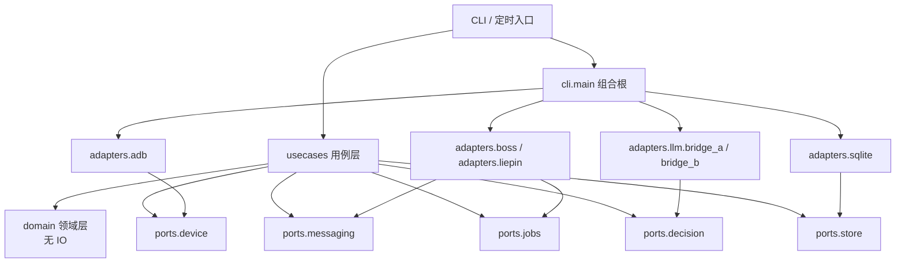

# 求职自动化 多应用扩展与分层 设计说明

> 文件用途：定义业务程序的分层、模块边界与端口/适配器结构，说明如何在不改核心的前提下接入第二个手机应用（如猎聘），并给出可维护性约束、反模式与迁移步骤。本文是设计建议，不代表相关代码已存在；与《BOSS直聘_求职自动化_简化架构设计说明》配套阅读。

## 0 范围

- 上游依据：[`BOSS直聘_求职自动化_简化架构设计说明_20261123.md`](BOSS直聘_求职自动化_简化架构设计说明_20261123.md) 与 [`BOSS直聘_求职自动化_实施计划_20261123.md`](BOSS直聘_求职自动化_实施计划_20261123.md)。
- 本文解决两个问题：程序怎么分层分模块；加第二个应用时改哪里、不改哪里。
- 不在本文范围：具体选择器、具体页面 ID、具体业务策略数值；这些属于适配器与后续标定。

实施顺序与范围以实施计划 M0–M2 为准；本轮先实现 BOSS 的合成只读路径，不创建猎聘或其它空适配器。类型首次定义及 v1 schema 以[简化架构设计说明](BOSS直聘_求职自动化_简化架构设计说明_20261123.md) §5–6 为唯一来源：`ReadResult` 为读取三态，`Evidence` 为动作结果，`DecisionEnvelope` 为模型单次请求。本文补充依赖方向与端口映射，不另立一套字段。

## 1 设计目标与判据

| 目标 | 可检验的判据 |
|---|---|
| 加应用不改核心 | 新增 `adapters/<app>/` 后，`domain/` 与 `usecases/` 零改动 |
| 换模型不改业务 | 只替换 `DecisionPort` 实现，调度、护栏、证据不变 |
| 换存储不改业务 | 只替换 `StorePort` 实现，领域规则不变 |
| 选择器漂移可局部修复 | 只改对应适配器的页面/解析文件 |
| 领域规则可离线测试 | `domain/` 无 IO 依赖，可用纯内存对象测试 |

## 2 分层与依赖方向



依赖规则：

1. 箭头表示源码 import，不表示调用时序；用例依赖端口，适配器依赖并实现端口，端口不得 import 适配器。组合根 `cli/main.py` 创建实现并注入用例，是唯一可导入适配器的 CLI 模块。
2. `domain/` 不得 import `adapters/`、`adb`、`sqlite3`，不得出现具体应用名或平台控件名。
3. 端口只定义能力，不暴露控件、坐标、XML 节点。
4. 适配器只返回领域对象，不写数据库、不改调度、不决定策略档位。

这四条用静态 import 方向检查和 `domain/` 平台关键词扫描（具体应用常量、`uiautomator`、`sqlite3`）守住；组合根的注入例外须在检查中显式列出，不能把所有 CLI 模块都豁免。

## 3 模块划分

```text
app/
  __main__.py          # python -m app，调用 cli.main
  cli/                 # 参数解析、实施计划约定的 JSON 输出
    main.py            # 组合根与子命令分派
  usecases/
    doctor.py          # M0 只读探针
    sense.py           # M2 合成快照解析与发现入库
    round.py           # 一轮调度
    message.py         # 读消息 → 决策 → 回复
    job.py             # 单条职位
    cleanup.py
    reconcile.py       # 断连 / unknown 对账
  domain/
    models.py          # Task, Message, Job, Evidence, ReadResult
    scheduler.py       # 任务级优先级、抢占点
    policy.py          # A/B/C 档、动作护栏
    contract.py        # envelope / decision 校验
    errors.py          # 原因码词表
  ports/
    device.py          # dump / tap / type / back / screenshot
    messaging.py       # 消息类应用能力
    jobs.py            # 职位类应用能力
    decision.py        # decide(envelope)
    store.py           # 仓储接口
  adapters/
    adb/device.py
    sqlite/{schema.py, repo.py}
    boss/{pages.py, list.py, chat.py, actions.py, adapter.py, profiles/}
    liepin/{pages.py, list.py, chat.py, actions.py, adapter.py}
    llm/{bridge_a.py, bridge_b.py}
```

| 模块 | 职责 | 允许依赖 |
|---|---|---|
| `domain` | 状态机、优先级、策略、契约校验 | 仅标准库与自身 |
| `usecases` | 组织一次业务动作的步骤 | domain、ports |
| `ports` | 抽象能力声明 | domain 的模型类型 |
| `adapters` | 具体平台实现 | ports、domain 模型 |
| `cli` | 输入输出与组合根注入 | usecases；仅 main 允许 adapters |

这是最终分层位置示意，按里程碑逐步创建；M0–M2 的具体文件见实施计划 §5，不并行保留平铺的 `app/db.py` 等入口。配置校验在 CLI，暂不建空 config 模块。新增承载文件的自有目录必须同步创建 `AGENTS.md` 与只含 `@AGENTS.md` 的 `CLAUDE.md`；自动生成运行产物适用根指南豁免。

## 4 通用与特有的边界

| 通用（领域层） | 应用特有（适配器） |
|---|---|
| 队列、租约、任务状态机 | 页面定义与识别信号 |
| 优先级、抢占、预算 | 列表行解析、未读判定 |
| Evidence.outcome `performed/not_performed/unknown`，effect 区分 sent/request_sent/deleted/applied | 动作序列与控件定位 |
| 策略分档 A/B/C | 弹窗、输入法、版式差异 |
| 决策 envelope / decision | 联系人、职位卡字段名 |
| 幂等键规则、审计事件 | 版本兼容范围 |

一句话：领域层决定“要不要做、怎样算成功”，适配器决定“在这个应用里怎么点”。

## 5 端口设计

### 5.1 按能力拆分，避免胖接口

```python
class MessagingApp(Protocol):
    name: str
    def list_conversations(self, dev: DevicePort) -> ReadResult[UnreadSnapshot]: ...
    def read_conversation(self, dev: DevicePort, key: str) -> ReadResult[Conversation]: ...
    def send_text(self, dev: DevicePort, key: str, text: str) -> Evidence: ...
    def send_resume(self, dev: DevicePort, key: str) -> Evidence: ...
    def request_contact(self, dev: DevicePort, key: str, kind: Literal["wechat", "phone"]) -> Evidence: ...
    def delete_conversation(self, dev: DevicePort, key: str) -> Evidence: ...

class JobsApp(Protocol):
    name: str
    def list_jobs(self, dev: DevicePort) -> ReadResult[list[JobCard]]: ...
    def open_job(self, dev: DevicePort, key: str) -> ReadResult[JobCard]: ...
    def apply_job(self, dev: DevicePort, key: str) -> Evidence: ...
```

- 猎聘若只做消息，只实现 `MessagingApp`；BOSS 两个都实现。
- 核心按能力判断，不要求空方法。
- 适配器不得：写库、改调度、决定档位、重试、直接调用模型。

以上是能力签名示意，不是 M0 要预建的全部代码。`name` 为应用 ID；各方法的 key 为含应用前缀的稳定会话/职位键；读取三态与 `UnreadSnapshot` 字段直接复用设计说明 §5.3，禁止空列表替代失败。M2 先实现 `adapters/boss/list.py` 的纯函数 `parse_snapshot(xml_text: str, profile: dict, baseline_rows: list[dict], observed_at: str, snapshot_id: str) -> ReadResult[UnreadSnapshot]`，每页返回 viewport；合并函数位于同文件，签名为 `merge_snapshots(pages: list[ReadResult], profile: dict, baseline_rows: list[dict], coverage_proof: dict, now: str) -> ReadResult[UnreadSnapshot]`，执行实施计划 M2 的重叠段、身份冲突及覆盖校验，使用相同基线重算预览源。调用参数均为已校验合成对象，非法夹具返回 failed/invalid_fixture，损坏 XML 为 failed/invalid_xml、过期为 undetermined/stale_snapshot、缺列表为 failed/wrong_page、多列表为 undetermined/incomplete_snapshot、未标定/版本不符为 undetermined/uncalibrated_profile，value=null，不落部分业务行；列表内局部字段未知仍返回 ok 并保留其它明确正候选。两个函数均不 IO，由 sense 用例读文件和库，不调用上述真实设备方法。`Conversation/JobCard` 的正文与跨屏 schema 在 M3/M6 开始前定稿，本轮不用于 M0–M2 持久化。动作由用例先校验授权/幂等键并写 pending 后才可调用适配器，适配器仅负责一次执行和 Evidence；不支持的能力不注册、不调度，不能用空返回表示已实现。

### 5.2 其余端口

| 端口 | 职责 | 备注 |
|---|---|---|
| `DevicePort` | 读层级、点按、输入、返回、截图；M0 仅实现 probe | probe 输入输出与原因码沿用实施计划 M0，fixture 通道不启动子进程；其余能力按里程碑添加 |
| `DecisionPort` | 输入 envelope，返回 decision | A/B 桥接方式可切换 |
| `StorePort` | 业务候选、租约、证据、审计 | M1 的 upsert_snapshot 接收完整 ReadResult，返回写后仍 queued 的候选键；start/renew 返回 Lease，finish 需匹配结果证明；recover 内部取得停止证明，running 恢复保留设备隔离；完整类型、允许值和 StoreError 词表由设计说明 §6 统一定义，先 SQLite |

## 6 多应用共存

### 6.1 设备租约是全局的

一台手机只有一条 ADB。即使用户同时启用 BOSS 与猎聘，设备租约也必须跨应用串行，不能各自加锁。

### 6.2 键带应用前缀

```text
boss:conv:<hash>
liepin:conv:<hash>
```

数据表增加 `app TEXT NOT NULL`，唯一键改为 `(app, key)`。跨应用撞键会导致身份核验、幂等、审计全部失真。

这是未来增量迁移的表述；本项目尚无业务库，M1 从第一版就建 `(app,key)` 组合主键，并保持 key 的应用前缀，两者必须一致。M1–M2 的 app CHECK 仅允许 boss，第二应用启用时经版本迁移显式扩展，不为未实现应用预先放宽输入。`device_lease` 为跨应用全局记录，`events.app` 允许 null 表示设备全局事件，是这条规则的明确例外；不能为每个 app 各建一份设备租约。设备行的 held/quarantined 均阻止领取，过期不等于可覆盖；running 的停止恢复只关闭任务租约，保留全局隔离直到后续人工对账入口确认设备子命令与现场均已收敛，M0–M2 不实现解除隔离。

### 6.3 跨应用统一优先级

```text
BOSS 未读     100
猎聘 未读      90
BOSS 新消息读取 80
猎聘 新消息读取 70
BOSS 职位      50
猎聘 职位      40
任一清理       10
```

这些数值是未来多应用的固定排序建议，类型顺序始终为未读 > 新消息读取 > 职位 > 归档；未启用的应用完全不参与调度。新消息读取指会话预览相对已验证基线变化但无明确未读角标，按会话和入站消息身份与未读去重。数据库 priority 仅作同类型排序，不拿它覆盖跨类型顺序。

默认 M0–M2 只启用 BOSS 合成路径，不做动态权重。每次取任务先合并所有已启用应用的当前信号；可定位的明确未读先处理，未读未知且无定位目标时先定向核对，仍未知整轮暂停，有未读计数但无可定位目标也不能继续职位。仅预览变化为正但其它未读源未知时同样先核对，不能用预览变化覆盖未知；具体谓词沿用设计说明 §4.2.2。安全点须同时满足回到列表、输入框空、无确认框、无在途设备命令、上一动作状态与检查点已提交；pending/unknown 不允许跨应用切换。职位每条完成后检查；事务开发基线 30 秒、每轮 900 秒/200 次调用/20 条候选、5 次抢占（第 6 次暂停），租约 60 秒每 20 秒续租，与设计说明 §4.2/§6/§10 一致。`waited_ms` 从首次观察起算，不证明实际到达后的等待；持续未读可能使职位饥饿，达到预算就暂停，不降低未读优先级。

### 6.4 配置与版本门禁

```json
{
  "apps": {
    "boss":   {"enabled": true,  "observed_versions": ["14.200"], "write_profile_verified": false},
    "liepin": {"enabled": false, "observed_versions": [], "write_profile_verified": false}
  }
}
```

本片段仅示意后续多应用配置，不是 M0 最小配置可接受的字段，也不修改当前空示例。observed_versions 记录精确观测版本，不代表已经支持全部操作；未知版本、判定失败或 profile 未标定均停止相应设备用例并报 `uncalibrated_profile`，可继续使用合成只读夹具。禁止用 `14.x/7.x` 等未经验证的范围放行写入；实际版本获取与写入 profile 的确认流程仍待确认。

## 7 数据与迁移

- 业务表统一加 `app` 列；迁移时为历史行填默认应用名，避免空值参与唯一键。
- 会话、消息、动作、职位、审计都带 `app`，统计按应用分桶。
- 不按应用拆库：跨应用调度、审计、清理保护都需要同一事务视图。

M1 新库直接采用设计说明 §6 的 v1；不读取或迁移旧项目业务库。本项目将来增加应用时，先 SQLite backup API 本机备份，再在单个事务内回填 app、检查组合键与前缀一致、建立约束、更新 user_version；任一冲突回滚并报 migration_failed，不自动合并会话。未知版本库拒绝打开；重复执行当前版本初始化不得改写业务数据。

## 8 可维护性约束

| 约束 | 做法 |
|---|---|
| 契约测试 | 每个适配器一套合成 UI 夹具：有未读 / 无未读 / 判不出 / 动作成功 / 动作未知 |
| 核心纯洁性 | 静态检查 `domain` 的 import 与关键词 |
| 证据词表统一 | 适配器把平台文案映射为共享三态，禁止自定义字符串 |
| 变更影响可预测 | 见下表 |
| 文档同步 | 每个新目录建 `AGENTS.md`，写明选择器来源与版本 |

### 8.1 变更影响矩阵

| 变更 | 只需改 |
|---|---|
| 页面改版、选择器漂移 | 对应 `adapters/<app>/` |
| 新增应用 | 新增 `adapters/<app>/` + 配置 + 夹具 |
| 调整 A/B/C 档 | `domain/policy.py` + 配置 |
| 换模型或换桥 | `adapters/llm/` |
| 换存储 | `adapters/sqlite/` |
| 调整优先级 | `domain/scheduler.py` |

## 9 加猎聘的步骤

1. M0 起按上述路径放置 BOSS 实现；接猎聘时复用 `MessagingApp` / `JobsApp`，不再进行一次平铺代码搬迁。组合根新增注册项与静态优先级映射，核心按能力工作；只有现有端口已覆盖的新应用才承诺用例与领域零改动。
2. 猎聘按顺序实现：`pages.py`（页面信号）→ `list.py`（行解析 + 未读）→ `chat.py`（会话解析）→ `actions.py`（发送/联系方式/删除）。
3. 跑同一套契约测试；缺能力就把对应接口标记为未实现，不写空返回。
4. 加入应用权重与键前缀；先在只读模式跑通。
5. 再开草稿，最后在策略及本轮动作授权均有效时开 A 档；应用开关或适配器存在不构成发送授权。读取阶梯仍是 XML → 像素 → 可选视觉 → 本机人工，视觉默认关闭且不作为发送/删除证明。业务 Skills 不恢复，程序循环 + 提示词 + 操作手册的结论与实施计划 §7 一致。

## 10 反模式

- 插件加载器、动态发现、注册中心：两个应用用 `dict` 注册即可。
- 通用 UI 动作 DSL：动作序列属于适配器，不做跨应用抽象。
- 把选择器、包名、页面名放进领域层。
- 为第二个应用 fork 整个仓库。
- 强行共享应用特有的未读选择器或阈值：信号形态需各自验证；三态聚合、未知出口和安全点规则仍共用。
- 把应用特有阈值放进全局配置。
- 在适配器里写数据库或改调度。

## 11 权衡

| 取舍 | 代价 | 理由 |
|---|---|---|
| 现在就留端口缝 | 多一层间接 | 第二个应用已明确计划，缝的成本低于事后重构 |
| 不做插件框架 | 新增应用需改注册表 | 两个实现不需要框架 |
| 不拆库 | 单库变大 | 跨应用调度与审计需要同一事务视图 |
| 优先级写死 | 不灵活 | 排序是规则，灵活性收益低于不确定性成本 |
| 适配器自治 | 可能重复少量代码 | 共用逻辑抽到领域层，不强行共用选择器 |

## 12 待确认

1. 猎聘是否同时具备消息与职位流，还是只做其中一类。
2. 是否允许两个应用在同一轮内交替处理（默认允许，按优先级）。
3. 应用版本范围如何获取与校验（包信息、界面信号、人工确认）。
4. 是否为每个应用单独设置预算上限。
5. 未来是否需要第三个应用；若需要，注册表是否足够。

以上为后续生产或多应用启用前的待确认项，不当成既定事实或授权。M0–M2 的无设备合成验证、单应用只读、默认预算与租约可直接按上游契约实现，不需先决定猎聘范围、版本校验方式或第三应用；未验证的真实版本/profile 走未知出口。
