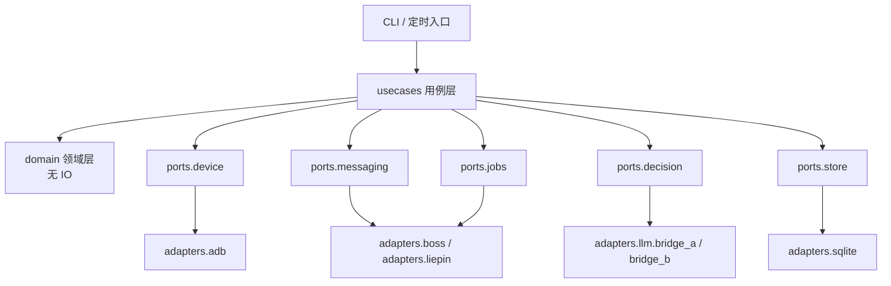

# 求职自动化 多应用扩展与分层 设计说明

> 文件用途：定义业务程序的分层、模块边界与端口/适配器结构，说明如何在不改核心的前提下接入第二个手机应用（如猎聘），并给出可维护性约束、反模式与迁移步骤。本文是设计建议，不代表相关代码已存在；与《BOSS直聘_求职自动化_简化架构设计说明》配套阅读。

## 0 范围

- 上游依据：[`BOSS直聘_求职自动化_简化架构设计说明_20261123.md`](BOSS直聘_求职自动化_简化架构设计说明_20261123.md) 与 [`BOSS直聘_求职自动化_实施计划_20261123.md`](BOSS直聘_求职自动化_实施计划_20261123.md)。
- 本文解决两个问题：程序怎么分层分模块；加第二个应用时改哪里、不改哪里。
- 不在本文范围：具体选择器、具体页面 ID、具体业务策略数值；这些属于适配器与后续标定。

## 1 设计目标与判据

| 目标 | 可检验的判据 |
|---|---|
| 加应用不改核心 | 新增 `adapters/<app>/` 后，`domain/` 与 `usecases/` 零改动 |
| 换模型不改业务 | 只替换 `DecisionPort` 实现，调度、护栏、证据不变 |
| 换存储不改业务 | 只替换 `StorePort` 实现，领域规则不变 |
| 选择器漂移可局部修复 | 只改对应适配器的页面/解析文件 |
| 领域规则可离线测试 | `domain/` 无 IO 依赖，可用纯内存对象测试 |

## 2 分层与依赖方向



依赖规则：

1. 只允许上层依赖下层，禁止反向。
2. `domain/` 不得 import `adapters/`、`adb`、`sqlite3`，不得出现具体应用名或平台控件名。
3. 端口只定义能力，不暴露控件、坐标、XML 节点。
4. 适配器只返回领域对象，不写数据库、不改调度、不决定策略档位。

这三条可以用两条测试守住：一条静态检查 import 方向，一条扫描 `domain/` 的关键词（应用名、`uiautomator`、`sqlite3`）。

## 3 模块划分

```text
app/
  cli/                 # 参数解析、人类可读输出
  usecases/
    round.py           # 一轮调度
    message.py         # 读消息 → 决策 → 回复
    job.py             # 单条职位
    cleanup.py
    reconcile.py       # 断连 / unknown 对账
  domain/
    models.py          # Task, Message, Job, Evidence, ReadResult
    scheduler.py       # 任务级优先级、抢占点
    policy.py          # A/B/C 档、动作护栏
    contract.py        # envelope / decision 校验
    errors.py          # 原因码词表
  ports/
    device.py          # dump / tap / type / back / screenshot
    messaging.py       # 消息类应用能力
    jobs.py            # 职位类应用能力
    decision.py        # decide(envelope)
    store.py           # 仓储接口
  adapters/
    adb/device.py
    sqlite/{schema.py, repo.py}
    boss/{pages.py, list.py, chat.py, actions.py, adapter.py}
    liepin/{pages.py, list.py, chat.py, actions.py, adapter.py}
    llm/{bridge_a.py, bridge_b.py}
  config/
```

| 模块 | 职责 | 允许依赖 |
|---|---|---|
| `domain` | 状态机、优先级、策略、契约校验 | 仅标准库与自身 |
| `usecases` | 组织一次业务动作的步骤 | domain、ports |
| `ports` | 抽象能力声明 | domain 的模型类型 |
| `adapters` | 具体平台实现 | ports、domain 模型 |
| `cli` | 输入输出 | usecases |

新增目录时必须同步创建对应的 `AGENTS.md` 与 `CLAUDE.md`。

## 4 通用与特有的边界

| 通用（领域层） | 应用特有（适配器） |
|---|---|
| 队列、租约、任务状态机 | 页面定义与识别信号 |
| 优先级、抢占、预算 | 列表行解析、未读判定 |
| 证据三态 `sent` / `not_sent` / `unknown` | 动作序列与控件定位 |
| 策略分档 A/B/C | 弹窗、输入法、版式差异 |
| 决策 envelope / decision | 联系人、职位卡字段名 |
| 幂等键规则、审计事件 | 版本兼容范围 |

一句话：领域层决定“要不要做、怎样算成功”，适配器决定“在这个应用里怎么点”。

## 5 端口设计

### 5.1 按能力拆分，避免胖接口

```python
class MessagingApp(Protocol):
    name: str
    def list_conversations(self, dev) -> list[ConversationRow] | Undetermined: ...
    def read_conversation(self, dev, key) -> Conversation | Undetermined: ...
    def send_text(self, dev, key, text) -> Evidence: ...
    def send_resume(self, dev, key) -> Evidence: ...
    def request_contact(self, dev, key, kind) -> Evidence: ...
    def delete_conversation(self, dev, key) -> Evidence: ...

class JobsApp(Protocol):
    name: str
    def list_jobs(self, dev) -> list[JobCard] | Undetermined: ...
    def open_job(self, dev, key) -> ReadResult: ...
    def apply_job(self, dev, key) -> Evidence: ...
```

- 猎聘若只做消息，只实现 `MessagingApp`；BOSS 两个都实现。
- 核心按能力判断，不要求空方法。
- 适配器不得：写库、改调度、决定档位、重试、直接调用模型。

### 5.2 其余端口

| 端口 | 职责 | 备注 |
|---|---|---|
| `DevicePort` | 读层级、点按、输入、返回、截图 | 未来可换 scrcpy 或别的通道 |
| `DecisionPort` | 输入 envelope，返回 decision | A/B 桥接方式可切换 |
| `StorePort` | 任务、租约、证据、审计 | 先 SQLite，未来可换 |

## 6 多应用共存

### 6.1 设备租约是全局的

一台手机只有一条 ADB。即使用户同时启用 BOSS 与猎聘，设备租约也必须跨应用串行，不能各自加锁。

### 6.2 键带应用前缀

```text
boss:conv:<hash>
liepin:conv:<hash>
```

数据表增加 `app TEXT NOT NULL`，唯一键改为 `(app, key)`。跨应用撞键会导致身份核验、幂等、审计全部失真。

### 6.3 跨应用统一优先级

```text
BOSS 未读     100
猎聘 未读      90
BOSS 职位      50
猎聘 职位      40
任一清理       10
```

默认写死，不做动态调整；需要时再配置。抢占仍遵循“安全点 + 有界延迟”。

### 6.4 配置与版本门禁

```json
{
  "apps": {
    "boss":   {"enabled": true,  "version_range": ["14.x"]},
    "liepin": {"enabled": false, "version_range": ["7.x"]}
  }
}
```

版本不在范围时，适配器降级为只读或禁用，不允许“先跑跑看”。版本判定失败按 `undetermined` 处理。

## 7 数据与迁移

- 业务表统一加 `app` 列；迁移时为历史行填默认应用名，避免空值参与唯一键。
- 会话、消息、动作、职位、审计都带 `app`，统计按应用分桶。
- 不按应用拆库：跨应用调度、审计、清理保护都需要同一事务视图。

## 8 可维护性约束

| 约束 | 做法 |
|---|---|
| 契约测试 | 每个适配器一套合成 UI 夹具：有未读 / 无未读 / 判不出 / 动作成功 / 动作未知 |
| 核心纯洁性 | 静态检查 `domain` 的 import 与关键词 |
| 证据词表统一 | 适配器把平台文案映射为共享三态，禁止自定义字符串 |
| 变更影响可预测 | 见下表 |
| 文档同步 | 每个新目录建 `AGENTS.md`，写明选择器来源与版本 |

### 8.1 变更影响矩阵

| 变更 | 只需改 |
|---|---|
| 页面改版、选择器漂移 | 对应 `adapters/<app>/` |
| 新增应用 | 新增 `adapters/<app>/` + 配置 + 夹具 |
| 调整 A/B/C 档 | `domain/policy.py` + 配置 |
| 换模型或换桥 | `adapters/llm/` |
| 换存储 | `adapters/sqlite/` |
| 调整优先级 | `domain/scheduler.py` |

## 9 加猎聘的步骤

1. 先抽 `MessagingApp` / `JobsApp` 接口，把 BOSS 代码移入 `adapters/boss/`；核心零改动。
2. 猎聘按顺序实现：`pages.py`（页面信号）→ `list.py`（行解析 + 未读）→ `chat.py`（会话解析）→ `actions.py`（发送/联系方式/删除）。
3. 跑同一套契约测试；缺能力就把对应接口标记为未实现，不写空返回。
4. 加入应用权重与键前缀；先在只读模式跑通。
5. 再开草稿，最后开 A 档自动发送。

## 10 反模式

- 插件加载器、动态发现、注册中心：两个应用用 `dict` 注册即可。
- 通用 UI 动作 DSL：动作序列属于适配器，不做跨应用抽象。
- 把选择器、包名、页面名放进领域层。
- 为第二个应用 fork 整个仓库。
- 共享未读判定逻辑：不同应用的信号形态一定不同。
- 把应用特有阈值放进全局配置。
- 在适配器里写数据库或改调度。

## 11 权衡

| 取舍 | 代价 | 理由 |
|---|---|---|
| 现在就留端口缝 | 多一层间接 | 第二个应用已明确计划，缝的成本低于事后重构 |
| 不做插件框架 | 新增应用需改注册表 | 两个实现不需要框架 |
| 不拆库 | 单库变大 | 跨应用调度与审计需要同一事务视图 |
| 优先级写死 | 不灵活 | 排序是规则，灵活性收益低于不确定性成本 |
| 适配器自治 | 可能重复少量代码 | 共用逻辑抽到领域层，不强行共用选择器 |

## 12 待确认

1. 猎聘是否同时具备消息与职位流，还是只做其中一类。
2. 是否允许两个应用在同一轮内交替处理（默认允许，按优先级）。
3. 应用版本范围如何获取与校验（包信息、界面信号、人工确认）。
4. 是否为每个应用单独设置预算上限。
5. 未来是否需要第三个应用；若需要，注册表是否足够。

以上为待确认项，不得在实现中当成既定事实。
