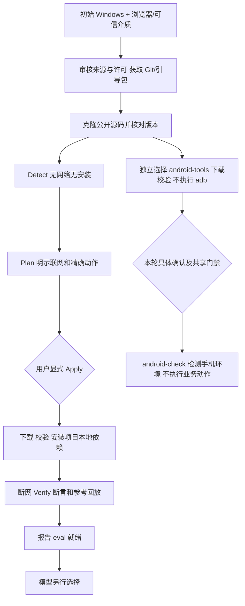

# 求职自动化 新环境自动化部署方案

> 用途：从没有项目运行时、Git 或包管理器的初始 Windows 环境出发，设计可审阅、可恢复的部署入口，覆盖合成评测、ADB 工具准备与手机环境检测，并区分可选模型评测和未来业务接入。原官方资料核对日期：2026-11-23；Android 补充及仓库引用复核日期：2026-11-24。本文仅为设计；本轮未实现安装器、未安装工具、未运行 ADB 或连接设备、未调用真实模型，也未完成干净机器验证。

## 1 结论与范围

首批平台为 **Windows 11 x64 + Windows PowerShell 5.1**，交付目标包括当前评测部署、独立的 Android 工具准备和经确认后的手机环境检测，不要求预装 Python、Node.js、Git、WinGet、Orca 或任何 agent。Windows PowerShell 随 Windows 提供；5.1 与 PowerShell 7 是不同产品，选择前者作为最小引导宿主，避免为了安装运行时先安装另一套运行时。[S01] 此处“初始环境”仍有明确下限：可正常启动的受支持 Windows、普通用户可写目录、浏览器或可信离线介质，以及允许执行经审核脚本的组织策略；不包括裸硬盘、操作系统安装或绕过组织管控。

默认目标为 `eval`：安装/选择合格的 Node 与 npm，按锁文件准备 promptfoo，最后断网运行断言与参考回放。Python >=3.13 保留为项目业务要求，但不是当前 Node 评测的执行依赖。`eval` 缺少 Python 时报告“业务环境未准备”，不能因此把评测失败或业务就绪混为一谈。

另设 `android-tools`（安装/静态校验 Platform-Tools，不执行 adb）和 `android-check`（本轮确认后检查真实手机）两个目标，详见 §8。手机检查不依赖业务 CLI 或真实模型交付，也不自动跟随 eval 执行；eval_ready、android_tools_prepared、device_environment_pass 和未来 business_ready 分别验收，不能合并成“部署全部成功”。本轮补齐设计，不实现这些目标。

首批不自动部署真实模型、Python 业务模块或开发编排工具。PowerShell 7、Windows ARM64、Windows Server、macOS、Linux、WSL 均为后续适配/验证项，不因脚本看似可运行就宣布支持。Windows 10 亦不列首批。具体 Windows 版本、补丁与策略组合由后续验收镜像清单记录，当前没有已验证的系统镜像。

## 2 现状证据与空白机器缺口

以下行号已在普通合并 main（基线 `a765ed5`）后复核；相对路径从项目根解释。既有架构文档中的旧代码引用只作为文档背景，本轮未访问旧项目或运行证据。

| 现状 | 公开证据 `file:line` | 初始环境缺口/部署决策 |
|---|---|---|
| Python 下限 3.13、依赖空、程序入口待设计 | `pyproject.toml:1`、`pyproject.toml:7`、`pyproject.toml:9`；`requirements.txt:1` | 没有现成业务安装或启动命令；不执行 `pip install -e .`，不恢复旧 Python 测试 |
| Node 下限 22.22.0，promptfoo 精确为 0.126.0 | `package.json:7`、`package.json:15` | 不依赖宿主恰好装好的版本；最低版本不是“推荐最新版本”，安装版本需另外冻结并验收 |
| npm 未单独规定版本；锁格式为 3，根包元数据与 package 一致 | `package-lock.json:4`、`package-lock.json:11`、`package-lock.json:14` | 记录所选 Node 发行包附带 npm 的精确版本，验证能消费锁文件；不虚构 npm 最低版本 |
| `npm test` 调用 Node 内置测试，仅使用仓库模块和合成案例 | `package.json:10`；`evals/assertions.test.cjs:4`、`evals/assertions.test.cjs:9` | 无 `node_modules`/promptfoo 也能运行；需要 Node，使用 npm 命令时也需要 npm |
| smoke 从项目 `node_modules/promptfoo` 取 CLI，回放参考答案 | `evals/run.cjs:22`、`evals/run.cjs:26` | 先 `npm ci` 准备开发依赖；全局 promptfoo 或 `npx` 临时下载不能替代 |
| 根 provider 为 echo 占位、关闭分享、并发 1 | `promptfooconfig.json:4`、`promptfooconfig.json:14`、`promptfooconfig.json:16` | 裸 promptfoo 不作为部署验收；使用仓库 smoke 入口 |
| model 要显式 provider，拒绝 echo/参考 provider | `evals/run.cjs:14`、`evals/run.cjs:15`；`evals/AGENTS.md:20` | 凭据、真实模型选择、费用与合成输入外发均是独立选择，部署不探测认证 |
| 入口关闭遥测/更新检查、分享、缓存及评测库保存，报告写 data/evals | `evals/run.cjs:20`、`evals/run.cjs:27`、`evals/run.cjs:38` | 这些是入口设置，不能从本机缓存推断初装可用；仍需断网证明没有隐式下载。当前入口继承父进程环境、输出本机报告目录，不是已实现的部署隔离/脱敏层 |
| 示例只有 policy_pack 路径 | `config.example.json:2`；`README.md:10`；`docs/BOSS直聘_求职自动化_实施计划_20261123.md:187` | 示例指向的默认策略包尚未交付，也不适用于未来 M0 的 doctor/sense；评测无需生成 config.json |
| 业务 CLI、SQLite、跨会话检索与设备执行器未实现 | `README.md:7`、`README.md:48`；`evals/AGENTS.md:48` | 不把初始化数据库或 `python -m app` 写入当前成功条件 |
| M0–M2 是未来契约，M4 才包括模型桥与 policy 接口 | `docs/BOSS直聘_求职自动化_实施计划_20261123.md:12`、同文件 `:185`、`:197`、`:236` | `doctor/store/policy/run` 均不可当成现成部署步骤；未来开发应另设验收目标 |
| 未来程序持有循环与状态；端口允许替换模型适配器 | `docs/BOSS直聘_求职自动化_简化架构设计说明_20261123.md:65`、同文件 `:72`、`:104`；`docs/求职自动化_多应用扩展与分层_设计说明_20261123.md:18` | 无依据将 Orca/Codex/OpenCode 固化为运行必需；外部 agent 桥只是未来联调选择 |
| 策略包流程、Python 入口、示例与 provider 帮助明确列为 M4 交付，尚未实现 | `docs/求职自动化_公开仓库与策略包_设计说明_20261123.md:181`、同文件 `:187`、`:233`、`:337`；`docs/AGENTS.md:47` | 初始工具获取由本文引导；现有 npm 评测不加载策略包，不可替代未来包评测，不复制旧包补缺 |
| 未来每 profile 独立业务库，真实 run 还须固定 OS 位置的共享设备门禁 | `docs/求职自动化_公开仓库与策略包_设计说明_20261123.md:270`、同文件 `:272`、`:274`；`docs/BOSS直聘_求职自动化_实施计划_20261123.md:238` | 门禁实现/迁移与并发测试未交付前禁止真实 run；当前 eval 不创建或访问门禁，也不能用跨项目工具隔离替代全局设备互斥 |
| 本机配置、数据、依赖与私有策略目录被忽略 | `.gitignore:2`、`.gitignore:10`、`.gitignore:24`、`.gitignore:31`、`.gitignore:35` | 忽略规则不是隔离实现或授权证明，也不保证已跟踪文件/历史安全 |

**待核实假设**：旧环境可能提供了 PATH/命令别名、合格运行时、已有 `.venv`、npm/二进制缓存、全局工具、代理/证书、模型认证、私有策略包或 USB 驱动。这些只是假设，不是本轮发现；不读取用户目录、环境变量、npm 配置、模型配置、私人文件或设备来求证。将来用无共享用户目录、无旧缓存的干净镜像检验这些前提，不把本机运行成功当作反证。

## 3 依赖矩阵与安装边界

| 能力/目标 | 系统或用户级工具 | 项目本地资产 | 网络、认证和设备 | 当前状态 |
|---|---|---|---|---|
| 初始引导/获取源码 | Windows PowerShell 5.1；Git 只用于 clone/版本管理；浏览器可取得可信引导包 | 审核过的源码/发行包 | 首次下载联网，或可信介质；公开仓库不需账号 | 获取流程可设计，部署入口未实现 |
| 断言自检 `npm test` | Node >=22.22.0、npm | evals 合成文件；无需 promptfoo | 自检离线，无密钥/手机 | 已实现 |
| 参考回放 `eval:smoke` | 同上 | `npm ci` 安装的 promptfoo 0.126.0 及锁定依赖；报告在 data/evals | 安装通常联网；自检须断网；无模型认证 | 已实现入口，初始环境待验收 |
| 可选真实模型评测 | 同上，不要求某个模型 CLI | 现有 model 入口 | 用户独立选 provider/配置认证；外发合成输入、可能计费 | 已实现入口，未选择/调用真实 provider |
| 未来业务离线路径 | Python >=3.13；标准库优先 | 将来新建本项目 `.venv`、源码/合成夹具及 profile 独立业务库；真实 run 的共享门禁另见 §8 | 无设备离线验收应独立成立 | 未实现，不纳入 eval 成功 |
| 未来业务模型桥/策略 | 按最终桥实现确定，不预装 agent | 公开模板、合成示例；本项目私有策略/库 | 凭据用户管理；桥未选定 | 未实现，不调用 policy 命令 |
| Android 工具准备 `android-tools` | Google Platform-Tools；按实际 OEM 单独处理 Windows USB 驱动 | 项目管理的固定工具版本与清单 | 下载与 SDK 许可；不执行 adb、不访问手机 | 本轮补齐安装/静态验收设计，入口未实现 |
| 手机环境检测 `android-check` | 已选定的 adb 与已准备的 USB 驱动 | 检查器及跨 worktree 共享设备门禁；仅本机脱敏报告 | 本轮确认、USB 调试/RSA 用户操作；首批仅 USB | 本轮补齐检查/失败/验收设计；未运行，不代表业务可用 |
| 开发编排 | Orca、Codex、OpenCode/其它 IDE 为开发者可选工具 | 不生成或迁移其模型配置/Skills | 由开发者独立安装/认证 | 不是当前评测或未来业务的默认依赖 |

系统安装与项目资产必须分开：已有合格工具只复用明确选定的可执行文件，不升级/卸载共享安装；新增 Node 优先解压官方 Windows ZIP 到本项目管理的 `data/evals/deploy/tools/`，配套 npm 同来源，调用显式路径。Git 在取得源码前需临时用户目录承载官方 Portable Git；克隆后可保留作为外部只读工具，由用户另行清理。WinGet 已有时可作为可选安装后端，不为使用 WinGet 再递归引入第三方包管理器。[S02][S03][S04]

评测的 `node_modules`、下载暂存、工具与 npm 缓存/状态均放当前项目忽略的 `data/evals/deploy/` 或已有 `node_modules`；独立 Android 目标的工具/计划/脱敏报告拟放被忽略的 `data/deploy/android/`，不依赖 npm。生成内容不提交，本轮不创建目录。Git 引导前的暂存区由用户选择，不借用旧项目目录。项目搬迁后重新解析相对根路径，不使用旧安装绝对路径。缓存可删可重建，不能是隐含必需品；不读全局 npm 缓存或从旧工作区复制 node_modules。

当前不需要 `.venv`：评测执行链完全在 Node，Python 第三方依赖为空。将来业务代码交付后，才建议用用户明确选定、达到下限的 CPython 创建本项目 `.venv`，直接调用 `.venv/Scripts/python.exe`，无需激活或改执行策略；不复制其它项目 venv。venv 是基于已有 Python 的隔离环境，不能引导 Python 自身，亦不是可搬迁发行包。[S05][S06]

## 4 最小自动化入口（全部拟议）

建议将来只新增一个根 `setup.ps1`，兼容 Windows PowerShell 5.1、UTF-8 BOM，使用 PowerShell/.NET 与平台现成下载/解压/进程能力；不引入安装框架、不要求 Python/Node 来运行入口。不在本轮创建脚本、清单或目录。

拟议接口如下，**文件和参数目前都不存在，所有部署示例均未执行、待实现后核实**。首批设计目标为 `eval`、`android-tools`、`android-check`，逐项实现验收；未交付的目标一律报 not_implemented，不做伪成功的空实现。

```powershell
# 拟议：已有审阅源码时，在项目根执行
powershell.exe -NoProfile -File .\setup.ps1 -Mode Detect -Target eval
powershell.exe -NoProfile -File .\setup.ps1 -Mode Plan -Target eval
powershell.exe -NoProfile -File .\setup.ps1 -Mode Apply -PlanFile .\data\evals\deploy\plan.json
powershell.exe -NoProfile -File .\setup.ps1 -Mode Verify -Target eval -Offline
# 拟议：Android 可独立选择，不要求先完成 eval；本轮均未执行
powershell.exe -NoProfile -File .\setup.ps1 -Mode Plan -Target android-tools
powershell.exe -NoProfile -File .\setup.ps1 -Mode Apply -PlanFile .\data\deploy\android\plan.json
powershell.exe -NoProfile -File .\setup.ps1 -Mode Verify -Target android-tools -Offline
# 拟议：仅在另获本轮具体确认和门禁后，由用户指定包名并选择设备
powershell.exe -NoProfile -File .\setup.ps1 -Mode Verify -Target android-check -PackageName '<target-package>'
```

| 模式 | 允许行为 | 拒绝行为/输出 |
|---|---|---|
| Detect | 读取公开元数据、OS/架构/宿主版本；只定位候选工具，不运行未经选择的包装器/别名；无网络 | 不创建文件、不安装、不读配置或环境秘密；stdout 为候选代号、版本状态/歧义和缺口 |
| Plan | 对固定官方来源解析候选发行版元数据（联网前明示）；生成项目本地计划；离线只能使用已审核清单 | 列明精确版本、来源/哈希、许可、范围、写入路径、联网端点、脚本执行、权限及验证项；缺可信元数据时标 unresolved、不得 Apply |
| Apply | 用户审阅计划后显式运行；按目标下载、校验、解压；只有 eval 安装 npm 依赖 | 不重新解析 latest、不修改锁文件、不自动升权；计划过期/源码或相关公开元数据哈希变化先重做 Plan；不自动进入手机检查 |
| Verify | eval 运行断言和 smoke；android-tools 只做文件/哈希静态验收；android-check 按 §8 的本轮确认和门禁运行 | `-Offline` 不下载补依赖；按所选目标报告结果；未选择或未确认设备检查时一律 device_not_checked，不把跳过计作通过 |

计划文件绑定 schema、目标、当前源码身份/公开元数据哈希、架构、资产哈希/来源及动作清单，并计算 `plan_hash`；eval 另绑定锁文件 SHA-256、Node/npm 精确版本和安装脚本策略，Android 另绑定 Platform-Tools 版本、目标包名与检查项。Apply 在操作前重新核对；工具选择不明时允许用户以拟议 `-NodeExecutable`/`-GitExecutable`/`-AdbExecutable` 显式指定，先给出新的计划。计划与状态只记工具别名和项目相对路径，本机外部路径及设备序列号仅会话内使用，不写公开报告或持久计划；保存过的计划不保存本轮设备许可。

检测先判断命令是否为真实应用、Store 执行别名、脚本、函数或多个候选；`python`/`py` 可能触发安装或选中不同解释器，不能盲目调用它们。[S05] Node 需用选定可执行文件读版本，按整数元组比较，不用字符串比较；版本 22.9 与 22.22 的顺序不可混淆。低于下限停止/计划并存安装；高于下限但未在验收矩阵出现的版本只记“满足声明，兼容待验证”，不能默认为生产支持。npm 必须来自所选 Node，避免另一个 PATH 中的 npm。

**隔离与输出设计要求**：新入口以 `-NoProfile` 启动，不枚举/打印环境、不读用户 `.npmrc`、Git 用户配置、模型配置、认证文件或根 config.json。给 npm 指定入口自己生成的空 userconfig/globalconfig 与项目缓存，并用清理继承的子进程环境，避免 `NODE_OPTIONS`、`NODE_PATH`、`NPM_CONFIG_*` 或 provider 凭据隐式生效；不通过读取/显示它们判断是否存在。需要的系统变量只由平台接口/所选工具路径构造。若有非公开项目 `.npmrc`，仅识别存在并报人工处理，不读取内容或自动采用。npm 可从命令行、环境和多层配置取配置，单给一个缓存参数并不能证明隔离。[S07] 此隔离层尚未实现，现有 run.cjs 的环境继承不能作为它的验收证据。

第三方安装器/命令 stdout、stderr 不直接透传到公开报告；错误按白名单映射原因码，不回显完整命令行、下载 URL 查询参数、用户名、绝对路径、代理地址或异常正文。下载端点仅允许无凭据 HTTPS 官方来源，禁止 URL 用户名密码和认证查询参数。公开证据只含版本、来源编号、哈希、步骤/退出码与合成案例 ID；原始输出若必须诊断，只能用户另行启用本机记录并先审阅，部署不上传。

## 5 从初始机器到离线自检的完整顺序



1. **获得入口而不预设 Git/包管理器**：用户从项目将来发布的公开发行页，通过浏览器或可信介质取得可审阅引导包与版本清单；发布页地址、签名/哈希信任渠道仍待维护者交付，当前没有一键引导发行物。不得先要求 `git clone` 才能拿到唯一安装 Git 的脚本。初始机器可先从 Git 官方安装页取得 Portable Git 或安装器，核对发行来源/签名和许可；不强制账号、管理员或 WinGet。[S03] 独立引导包与仓库内 setup 应使用同一份版本化源，避免两套实现。
2. **无 WinGet 的分支**：继续官方 Portable Git + Node ZIP 路线，不安装 Chocolatey/Scoop，不更改系统设置。已有 WinGet 可选用其精确 ID/来源和经核实版本的安装方案；Git 官方给出的 `winget install --id Git.Git -e --source winget` 只作官方示例，本轮未运行，不能保证包版本、用户级安装或免管理员。WinGet 依赖 App Installer，可能未安装，Windows Sandbox 也不应假定存在；不同包可能触发 UAC。[S02][S03]
3. **获取独立源码**：使用选定 Git 的显式路径，公开 HTTPS URL 不带认证，目标为新目录；核对维护者给出的 tag/commit 与发行清单。以下是 Git 官方语法的占位示例，未在空白机器执行；尖括号值必须由维护者公开资料替换，不使用本机 remote 或私人 URL 推断。[S08]

   ```powershell
   # 待核实示例：在用户选定工作目录，使用已审核 Git
   & '<selected-git.exe>' clone -- '<public-repository-https-url>' '.\求职 项目'
   Set-Location -LiteralPath '.\求职 项目'
   ```

   将来引导器在 clone 前使用它自己的空配置/模板和最小子进程环境，禁用用户/系统 Git 配置继承与 hooks/过滤器，不启用子模块，不读取 credential helper；相关隔离参数须在实现时逐项查 Git 官方说明并测试，本文不提供未经核实的参数拼接。源码 ZIP 可用于无 Git 评测，但报告须标 source_archive、记录归档哈希，不能声称做过 Git clone 验收。
4. **Detect/Plan**：以 Windows PowerShell 5.1 启动；读取 package/锁文件顶层元数据等公开输入，列明缺工具和所选安装路线。无 Python 不阻断 eval；没有 Node/npm 则在计划中获取二者。用户已装工具有歧义/不合格时计划并存工具，不删除原有版本。组织策略禁止脚本时停止，提供同一计划供管理员审核或手工执行；不能把绕过策略视为必要步骤。
5. **Apply 工具阶段**：先下载到 `.partial`，校验成功再解压到带版本的新目录；新目录验证后才写“可用”状态。所有路径通过 LiteralPath/参数数组传递，禁止字符串拼接执行；包含空格/中文/括号时行为一致。针对 .cmd 的调用/转义必须单独测试；Node/npm 可用明确 node.exe + 对应 npm-cli.js 避免误选 npm.ps1。引导器不持久写 PATH，子进程仅使用计划中的工具目录。用户选择系统安装后，新终端可能需要重新解析命令；先用明确路径验证，再提示重开终端，不用修改注册表或刷新全机环境。
6. **Apply 项目依赖阶段（通常联网）**：按当前锁文件执行 `npm ci` 而非 `npm install/update`；明确包含 dev 依赖。npm ci 在不匹配时失败，不应改锁；已有 node_modules 会被删除重装，因此必须提前列入计划，不能在失败后承诺原目录完整保留。[S09] 拟议安全初始选项是 `ci --include=dev --ignore-scripts --no-audit --no-fund`，附项目本地缓存与空配置。**这些选项组合未在干净机器验证**；promptfoo 的依赖是否需要 native/生命周期脚本尚未审计，禁脚本后 smoke 失败必须按失败上报，不能静默去掉选项、安装编译器或切换未锁版本。后续须审核锁文件对应安装脚本/预编译包，精确列出所需下载及许可；允许脚本执行的变化重做 Plan 并重新确认。`--no-audit` 只是避免额外请求，不代表依赖已经过安全审计。
7. **配置可选生成**：eval 默认不创建 config.json 或策略包。若用户另选“生成业务配置占位”，只从当前公开 `config.example.json` 排他创建本机 config.json；已存在则仅报告 preserved，不打开、不哈希、不备份、不覆盖。占位 policy_pack 路径不创建空目录，不证明策略已准备。无真实姓名、城市偏好、薪资、联系方式、发送额度、模型端点/认证等自动填充值，也不复制旧环境。完整业务 schema/默认示例包交付前只能报告 business_not_implemented。
8. **Verify（离线）**：联网安装完成后，由验收环境断开网络/阻止出站，再跑下列现有命令；禁止缺包时用 npx 或临时下载修复。以下命令在仓库已实现，**本轮只执行 npm test，smoke 的干净机器验收待做**。

   ```powershell
   npm test
   npm run eval:smoke
   ```

   入口实现时用选定 Node/npm 的明确路径调用等价命令。断言进程退出 0 且全部测试通过、smoke 24 个案例回放通过，才报告 eval_ready；smoke 仅验证参考链路，不代表模型或业务能力。只有断言通过时报告 assertion_only，不能报告完整 eval_ready。`-Offline` 是拟议入口约束，操作系统/VM 的出站封锁与网络计数才是无隐式联网的证据；不能把 CLI 开关当作网络隔离证明。

## 6 下载、许可、权限与版本供应链

| 资产 | 官方来源与冻结方式 | 校验/许可/权限边界 |
|---|---|---|
| Node + npm | Node 官方发行目录；已有 v22.22.0 Windows x64 ZIP 与 SHASUMS 文件可作为候选基线，不表示它是当前推荐补丁 | 计划冻结精确版本和文件名，核对 SHA-256 与可信清单；Node 官方提供签名校验说明。缺少可信哈希/签名验证链就停止，不自行把首次下载所得哈希当信任根。[S04][S10] ZIP 路线不写系统安装/不需提权 |
| Git | Git 官方页链接到 Git for Windows 的正式发行物 | 核对发布者/签名与审核清单；便携版自解压也是执行第三方程序，须计划中写清，不假称纯文件复制。系统安装的权限要求按所选发行物确认，不硬编码静默开关。[S03] |
| Python（后续） | python.org 官方渠道/安装管理器，选择满足 >=3.13 的可获得发行物 | 不编造固定 patch、安装器参数或 winget ID；先审核 per-user/无管理员方式与二进制支持，再固定。不能把嵌入式包当通用 Python/venv 的可替代品。[S05] |
| npm 锁依赖 | 当前 package-lock.json；首次下载默认公开 registry，锁内 resolved 端点须后续审核 | npm/锁格式兼容、完整性校验与生命周期脚本分别验收；锁完整并不证明脚本不会再下载。未经审核不替换镜像/降级 TLS/自动加不安全参数。[S07][S09] |
| Android 工具目标 | Google Platform-Tools 独立 Windows ZIP 或已有、显式选定的 SDK 工具 | 官方下载链接内容会变化，需冻结具体资产/版本和可信哈希；阅读并由有权用户接受 SDK 许可，不自动勾选或管道自动回答许可；复用/并存，不覆盖其它 SDK。[S11][S12] |

优先复用现成平台包管理能力或官方归档，不另写包管理器。WinGet 是可选后端，缺席不构成死锁；每个后端都必须给出相同的资产身份、范围、许可和验证结果。首批默认普通用户、项目本地可写路径；不自动提权、修改执行策略/证书库/防火墙/系统 PATH。PowerShell 的 Restricted、RemoteSigned、AllSigned 和组织组策略可能限制脚本执行，签名信任链与发布流程需在入口上线前解决；入口不加 Bypass，不偷偷 Unblock 或更改用户策略。组织禁止执行时给出 blocked_policy，而不是宣称所有空白机器均可无条件安装。[S13]

网络使用分三类记录：工具/源码/依赖下载是联网安装；断言和 smoke 是离线自检；真实 provider 请求是用户另选的外发。无网且没有已验证介质/完整缓存时，离线安装必须以 missing_artifact 失败并给出缺失资产代号，不借用用户缓存。完整离线包以后按同平台/架构、Node/npm、锁哈希准备并测试；第三方组件能否再分发需先核对许可，不能承诺打包全部 SDK。

代理只接受用户本轮提供的无认证地址或由用户独立配置的网络通道；不读取现有代理配置、代理密码/证书私钥，不把 URL 写日志。需代理认证或组织 CA 时返回需用户/管理员独立处理的网络前置项，保持 TLS 校验，不关闭 strict-ssl。DNS/超时/下载中断可有限重试（拟议最多 2 次），权限/哈希/签名/许可失败不重试；不关闭安全软件以求安装成功。

## 7 幂等、中断恢复与回滚

安装状态为逐资产的 `planned → downloaded → verified → installed → validated`；状态文件只含计划/资产哈希、相对路径、状态、错误码和检查结果，不存配置正文。用临时文件再原子替换状态，独占锁防止同一项目并行 Apply；无有效锁归属证明时停止，不自动杀进程或覆盖另一个安装。首次工具可用状态不是最终部署成功，验证失败必须保留失败标记。

| 情形 | 拟议行为 | 不承诺的回滚 |
|---|---|---|
| 同源码、锁与运行时重复 Apply | 重新校验已验证资产与安装完成标记；版本相同且检查通过则跳过下载/安装，只重做必要验证 | 不能只凭一个 success 文件跳过检查 |
| 下载中断/不完整文件 | 下次从可信完整资产重下；不实现复杂断点续传；失败临时文件只在自己暂存区处理 | `.partial` 永远不能执行；不把无校验缓存视为成功 |
| npm ci 中断/失败 | 保留失败状态，停止；用户修复原因后按同锁重新 ci，必要时重建当前项目 node_modules | ci 已移除的旧 node_modules 不保证恢复；不影响 config/私有包/业务数据 |
| 工具升级 | 显式新 Plan，安装到并存版本目录，全部验证后切换本项目指针 | 不覆盖系统工具；不跟随 latest 自动升级 |
| 新版本失败 | 若旧项目管理版本仍完好且对应旧锁/源码，可重新选择该完整组合 | 不回退已有业务数据库 schema；业务升级另设计 |
| 卸载/清理 | 另列可审阅计划，只删部署清单拥有、规范化后仍在本项目工具/缓存内的内容；有活动任务时拒绝 | 不删用户配置、私有策略、报告或业务库；不卸载借用的系统 Git/Node/Python，不递归删项目根 |

配置“保留”只需检查路径存在，不能为了证明保留而读取私人内容。将来验收可由测试夹具创建者对**合成** config.json 做前后哈希；生产部署不做该操作。旧项目 `.venv`、数据库、策略包及模型配置不属于恢复源。

拟议退出码在部署包装层统一，原命令退出码另记检查字段；不改变现有 eval 入口的语义：

| 码 | 含义 |
|---|---|
| 0 | 所请求阶段完成；Detect 无缺口/Verify 所选目标通过；Plan 已完整生成可审阅计划，不表示已安装 |
| 2 | 参数/元数据/路径/计划校验失败或请求未实现目标 |
| 3 | 工具缺失、版本/架构不符、候选歧义；Detect 有缺口 |
| 4 | 待显式应用、许可未接受、权限/组织策略阻断 |
| 5 | 网络/缺离线资产/哈希或签名验证失败 |
| 6 | 安装/子进程失败或中断残留待恢复 |
| 7 | 安装后自检或设备检查失败；不输出对应目标的通过状态 |
| 8 | 设备检查未获本轮确认、设备门禁占用/未知；本次无设备动作，报告 blocked |

原生系统关闭/进程被强杀可能拿不到以上退出码；下次根据不完整阶段和校验结果恢复，不能杜撰“正常回滚”。

## 8 独立的模型选择、ADB 部署与手机环境检测

**模型选择**：部署不选择或读写模型配置，不读取/回显凭据，也不“试连一下”。用户独立查所选 provider 文档，配置认证后，另行决定是否运行已存在的 `npm run eval:model -- "<provider-id>"`；该命令会外发合成输入，费用与服务条款由所选服务决定。报告只记 model_not_run 或真实独立评测的实际结果，不把凭据存在、smoke 通过或工具安装当作授权。模型流程不读取个人事实，也不产生手机发送或记忆写入动作。

### 8.1 电脑侧：android-tools

这一步属于部署范围，可在没有手机、Node、Python、模型认证的机器上独立完成。Detect 仅定位 adb 文件和候选版本清单，不运行任何 adb；多份安装需明确选择，不能取 PATH 第一项。Plan 复用 §6 的可信下载、许可与哈希要求，冻结 Platform-Tools 的精确版本、Windows ZIP、来源和安装相对路径；Apply 解压完整官方归档到 `data/deploy/android/tools/<version>/platform-tools/`，保留 adb 所需随包 DLL，不仅复制 adb.exe。不要求 Android Studio、完整 SDK、JDK 或 SDK Manager；若改用 SDK Manager，另补其运行时与许可验收。[S11][S12]

Verify 静态核对清单、文件存在及哈希，成功只报 android_tools_prepared、adb_runtime_not_checked、device_not_checked；执行文件能否启动、驱动与手机是否可用仍未知。**任何 adb 执行（包括 version、devices）均留到 8.2 获确认后。** OEM 驱动单列准备项，由用户按实际机型从官方渠道选择并安装，必要时另处理管理员权限；不能给所有品牌默认装 Google 驱动，不自动改驱动 INF。[S14][S17]

### 8.2 手机侧：android-check

该目标在业务实现之前即可独立交付，但检查器与共享设备门禁实现是前提；当前两者均不存在。下述命令是未来检查器的白名单设计，**本轮没有执行**。不把“ADB 呢/手机需要检测吗”视为设备确认，`-Target android-check` 或旧计划文件也不替代本轮具体确认。

1. 先展示动作：使用已选 adb 核对版本、枚举 USB 连接，选定手机后读取系统/目标应用元数据，并对用户准备的无私人内容页面做截图及 UI 层级可读性检查；预计占用 2–3 分钟，检查期间独占所选手机，可能启动本机 ADB 服务。用户先确认，再连接数据线、手动开启开发者选项和 USB 调试、解锁并决定是否接受 RSA 提示；不代点“始终允许”，不读取或复制 adb 私钥。[S14][S16]
2. 按既定同机同 OS 账户门禁方案取得检查占用；枚举和服务检查也须避免与其它客户端任务冲突。获得本轮确认及有效占用后才调用 adb；门禁缺失、占用、异常未知或其它工具正在使用同一服务时停止，不靠新 worktree、TTL 或另开 adb 服务绕过。枚举后把所选设备绑定到占用；多台设备由用户本轮明确选择，后续所有设备命令强制 `-s <serial>`，重连不自动改选。序列号仅在本机会话内用于命令与门禁，不进日志、持久计划或公开报告。[S16]
3. 逐项执行下表，拟议单命令超时 15 秒、全程最多 3 分钟；每项保存通过/失败/未知、原因码和退出码。命令退出 0 但解析为空、错误文本或不支持时也不能通过；超时仅结束本检查子进程，不 `kill-server`、不杀共享进程、不自动重启手机或无限 wait-for-device。断线/状态变化即停止，重新检查需重新确认；异常占用按已有门禁恢复契约处理。

| 检查 | 拟议最小探测/人工前置 | 通过判据与失败处理 |
|---|---|---|
| adb 运行与 USB 连接 | 显式选定 adb 的 `version`、`devices -l`；主机数据线/接口、设备管理器驱动与 RSA 由用户核对 | 运行版本与清单一致；选定真机为 device，并能执行下一项 shell。无设备报 no_device，unauthorized 提示用户解锁/确认 RSA，offline 报 device_offline；不循环弹授权、不把驱动存在当连通证明。[S16][S17] |
| 系统及启动状态 | `-s <serial> shell getprop ro.build.version.release`、`ro.build.version.sdk`、`ro.product.model`、`sys.boot_completed`，逐个属性读取 | 系统已启动、shell 可用、返回可解析；型号仅本地，公开用设备代号。Android/API 必须落在后续实际验收的组合清单；未知组合记 compatibility_unverified，不能把历史 Android 15 单机记录当通用支持。禁止全量 getprop。 |
| 屏幕与输入环境 | `shell wm size`、`shell wm density`、`shell settings get system accelerometer_rotation`、`shell settings get system user_rotation`、`shell settings get secure default_input_method`；用户核对亮屏/解锁、当前方向、语言/字体缩放/导航模式 | 分辨率/密度有效，物理值与覆盖值均识别；自动旋转开启时不能用 user_rotation 推断当前方向，实际方向以读屏结果为准。未适配布局或锁屏报 screen_not_ready；输入法仅记本地能力状态，不切换、不试输入，不套用旧坐标。 |
| 目标求职应用 | 用户明确包名（校验后作为参数，不拼接 shell）；`shell pm path <package>`、`shell dumpsys package <package>` 仅提取版本/启用状态 | 目标在所选 Android 用户/profile 中已安装并启用，版本在后续应用适配验收清单。工作资料/多用户需明确选择，否则报 profile_ambiguous；缺失/停用/未知版本分别报 app_missing/app_disabled/app_version_unverified。不全量列包、不安装/更新/清数据。[S16][S18] |
| 当前页面及账户前置 | 用户手动打开目标应用的无聊天/简历内容页面，人工确认已登录；核对无登录、升级、验证码、权限弹窗及遮挡 | 只记录用户确认的登录状态和页面类别，不采集账号。未登录/被阻断报 app_not_ready，由用户手动处理；安装存在或网络连通不等于已登录，不读取聊天作连通探针。 |
| 电源、网络与应用权限 | `shell dumpsys battery` 仅提取供电/电量状态；用户确认供电足以完成本轮检查、目标应用网络可用，并在系统设置核对本轮读屏所需权限 | 低电量风险或网络/权限未确认报 prerequisite_unconfirmed；只记状态，不读 SSID/IP/代理/账户、不发探测消息。后台省电限制和简历附件等权限按未来实际业务另验收，当前检查不修改或授予权限。 |
| 读屏链路 | `-s <serial> exec-out screencap -p`；候选 `-s <serial> shell uiautomator dump /dev/tty`，必须在受测系统核实该流式路径可用 | PNG 可解码、尺寸/方向与页面一致；XML 可解析、节点非空、包含目标应用且关键入口可辨识。黑屏/保护画面、XML 空/超时/权限拒绝分别失败，不因退出 0 通过。截图不是仅检查 PNG 头；UI 命令可能临时占用自动化服务，需包含在独占说明中。流式 dump 不支持则报 hierarchy_unavailable，不静默改写设备文件或安装 helper。[S16][S19] |

截图与层级可能含业务内容，即便为检测也只在本机处理，不外发模型；默认进程内消费后丢弃，报告只留尺寸、节点数、布尔检查和原因码。若需保存故障证据，另说明敏感范围并由用户选择被忽略的本机位置；不把完整 dumpsys、层级文本、截图或设备标识写入报告。PowerShell 5.1 的截图流应由 .NET 原样读取二进制 stdout，不能用文本管道/`>` 转存 PNG；解析器和超时行为须在实现时验证。

所有必需项通过才报 device_environment_pass，明确 **input_not_tested、business_not_implemented、send_not_authorized**；拒绝/未确认只报 device_not_checked，不能计作成功。读取链路失败时记录具体缺口，不自动启用视觉模型兜底。USB/RSA 成功不证明点击、返回、滑动或中文输入权限可用；如后续业务要验收这些能力，应单独提出动作/时长/独占确认，在合成测试页验证，不在 HR 对话里试输入/发送。root、辅助功能服务、ADB 输入法、OEM“安全设置”、常亮/后台白名单不设通用强制项；只在具体执行器确实需要时逐项解释并另验收，检测不自动修改这些设置。首批不配无线调试、不调用 adb connect/tcpip/pair，不使用安装/重启/刷机等命令。

**未来真实运行的存储边界**：上游策略包说明 §8 已选定“每 profile 独立业务库 + 同机同 OS 账户固定应用数据位置的共享 SQLite 设备门禁库”；该共享门禁跨 worktree/clone，覆盖整个真实 run（含 read_only），不按项目路径拆锁，异常保留占用，不能靠 TTL、换 profile 或重新部署解锁。其实现、旧库拒绝迁移和并发/崩溃验收仍是前置缺项，详见上表的源码行号。eval 与 android-tools 不创建、迁移、读取或清理共享门禁；android-check 只在门禁能力交付后按契约取得/释放检查占用，缺失时明确阻断，不能另建项目锁替代。项目本地工具/缓存边界不代表所有业务资产都放在项目内，eval_ready 不表示真实业务就绪。

## 9 实施阶段与可执行门槛

| 阶段 | 交付 | 门槛 |
|---|---|---|
| D0 本轮设计 | 本文、最小索引和 README 链接；公开 file:line 与官方来源 | 文档范围检查、RULES 原样、链接存在、`git diff --check`、`npm test`；不安装 |
| D1 初始引导与计划 | 同源发布的审阅引导包/setup.ps1；可信版本/哈希清单；Detect/Plan/明确退出码 | 无 Python/Node/Git/WinGet 镜像能取得 Git 与源码并生成计划；拒绝歧义/不安全路径；Detect 不写不联网 |
| D2 当前 eval 的 Apply/Verify | 官方工具归档、独立 npm 配置/环境、本地缓存、锁安装、脱敏状态/恢复 | 第 10 节首批矩阵全部通过；断网自检成功；不覆盖配置；安装脚本需求已审计；不是只在开发机跑一次 |
| D3 可选模型操作说明 | 用户选择与外发/计费说明，无部署自动认证 | 合成负例验证不配置 provider 时不会请求；真实调用单独获准、单独报告，不是部署发布门槛 |
| D4a Android 部署与手机检测 | 与 D2 可独立推进 android-tools；交付检查器和跨 worktree 共享门禁后交付 android-check，不等待完整业务/模型桥 | 第 10.1 节 A01–A08；工具静态验收无 adb，真实检测先确认；缺项/拒绝不报就绪；真实业务仍未实现 |
| D4b 未来业务 | 业务/策略接口、Python/venv、profile 业务库与共享设备门禁 | 不存在的模块不能通过；真实 run 前完成上游门禁/迁移/并发及输入能力验收；手机环境检查不能替代业务验收 |
| D5 其它平台 | 各自入口/官方来源/权限与镜像矩阵 | 对应平台完整验收后才列支持；不照搬 Windows 参数 |

D1/D2 开工不依赖真实模型或私人策略。维护者仍须确定发行入口、可信清单签发方式、运行时补丁组合与安装脚本审计结论；这些是后续实现交付物，不应由部署时读取旧环境来补齐。

## 10 干净 VM / Sandbox / CI 验收矩阵（待执行）

每行均要求记录：干净镜像 ID/OS/架构/PowerShell 版本、源码 commit 或归档哈希、计划/锁哈希、精确 Node/npm、步骤退出码、文件变更摘要、出站统计与合成案例数。记录先在本机保存并审阅，只公开脱敏摘要；路径替换为项目相对路径，外部工具用代号。测试机不映射宿主用户目录、旧项目、凭据、策略或缓存，不接手机。

VM 是无管理员/系统安装/中断恢复的主验收场所。Sandbox 可做一次性无包管理器/无运行时与离线复核，默认联网，须显式禁网来测离线；不能把其中管理员权限结果当普通账户证明。[S02][S15] CI 普通托管镜像常预装 Git/Node，只有清单明确且移除依赖/干净基础镜像的任务才算初始环境证据；常规 CI 只算补充回归。所有矩阵项当前均为待执行。

| ID/前置 | 操作 | 预期 | 应保存证据 |
|---|---|---|---|
| V01 空白 Win11 x64：无 Python/Node/Git/WinGet/npm 缓存，有浏览器与网络 | 按 §5 获取 Portable Git、clone、Detect→Plan→Apply；断网 Verify | 无运行时也能开始；eval_ready；业务未实现、模型未调用、设备未访问 | 镜像工具缺席清单、Git 获取/源码身份、各阶段码、52 项断言与24例 smoke、出站统计 |
| V02 仅有合格 Node/npm，无 node_modules，全程断网 | 先 `npm test`，再尝试 smoke | 断言全部通过；smoke 因缺依赖失败；不下载、不误报完整就绪 | node_modules 缺席证明、测试计数、smoke 非零/原因和零出站 |
| V03 V01 成功状态，无资产/锁变更 | 重复 Detect/Plan/Apply/Verify | 不重复安装/下载，不改锁与已选工具；仍能自检 | 安装调用计数、清单/锁前后哈希及阶段状态 |
| V04 创建者放入独立合成 config.json 与合成策略哨兵文件 | 选配置占位生成并重复 Apply | 已有文件只报 preserved，字节不变，未被打开；不读取策略 | 夹具创建者的前后哈希、文件访问审计；不使用真实私有文件 |
| V05 在下载、解压、npm ci 三个阶段分别强制中止 | 重启同计划 Apply/Verify | 不执行 partial，不伪称成功；重下/重装后通过；配置哨兵不变 | 注入点、不完整状态、重试次数、恢复后的测试结果 |
| V06 Node 低于下限/22.9 与22.22比较、多份 node/npm、Store别名/包装器、非首批架构 | Detect/Plan；对明确选定的坏版本尝试 Apply/Verify | 歧义/错版本非零；不启动未知包装器；不同 npm 不混用；不支持架构明确拒绝 | 合成命令候选清单、执行次数为零或所选代号、原因码 |
| V07 普通账户且拒绝 UAC，无可用 WinGet | 用 ZIP/Portable 路线完成；另对必须系统安装的可选方案拒绝权限 | eval 能在用户可写项目完成；系统选项报权限阻断且不自动升权 | 用户权限条件、仅项目/引导暂存写入、系统设置未改、最终自检 |
| V08 无网无资产；随后提供同平台已校验离线包，再去掉其中一个依赖资产 | Plan/Apply Offline；补齐后重跑；再次缺包 | 首次/缺包非零并列缺项；齐全后能安装和自检；零外联 | 离线资产清单、哈希、失败/成功码、出站封锁计数 |
| V09 DNS失败、无认证代理、需认证代理、下载断线/哈希错误 | 对下载后端分别注入失败与已获准代理条件 | 有界失败；不回显代理/认证；不关闭 TLS；哈希错不执行；修复后可恢复 | 只含代号的故障记录、有限重试计数、第三方执行次数 |
| V10 项目路径含空格、中文、括号；另有越界链接或不可写目录 | 完整部署；对越界/不可写路径尝试 Apply | 合法路径通过；越界/不可写提前失败；无截断/命令注入 | 相对路径夹具名、检查结果、写入边界摘要 |
| V11 两个独立项目 A/B，用不同工具组合与合成配置 | 分别部署，清理 A 的部署所有资产，再测 B | 不依赖全局包/旧 venv；B 不变且通过；无跨项目写入 | A/B 相对清单与哈希、配置哨兵/缓存隔离、B 自检 |
| V12 锁/package 不匹配、资产校验失败、禁脚本后 native 依赖失败 | Apply/Verify；尝试重用旧计划 | 非零；不改锁、不自动启用脚本/安装编译器、不换版本；需新计划 | 公开元数据前后哈希、原因码、外部安装调用计数 |
| V13 现有共享系统工具 + 项目自装新版本；模拟新版本自检失败 | 新计划并存升级、回到旧源码/锁/工具组合，再执行限定清理 | 系统工具/个人配置不改；旧组合可复验；不声称数据库回滚 | 选定组合清单、切换/失败检查、限定删除路径清单 |
| V14 组织策略禁止脚本/未信任签名、Apply 前计划或源码变更、两次并发 Apply | 启动/应用计划 | 策略不绕过；篡改/并发拒绝；无系统策略修改 | 外层启动错误或包装层码、计划哈希、锁竞争与写入计数 |
| V15 无模型认证、无 SDK、未插手机，合成 can_send=true 案例在集内 | 完整 eval，检查进程/出站/文件访问 | 不读敏感配置/环境，不运行任何 adb/provider/业务动作；仅 Node参考回放 | 子进程白名单、阻断日志、访问审计、24例中合成标识 |

可执行判据是阶段进程真实退出码 + 独立文件/网络/进程证据，不能仅凭安装器自己打印 success。V01、V03–V15 需未来实现入口后执行；V02 中的现有命令现在即可在合适的隔离环境执行。52 为本轮仓库断言数量，未来案例变化需更新基线，测试 0 项一律失败。

### 10.1 Android 独立验收矩阵（全部待执行）

A01–A03 在不接手机的干净 Windows 环境验证；A04–A08 必须另取得该轮具体确认并使用专用测试手机/合成页面。模拟 adb 输出只能验证解析/分支，真实 USB、RSA、屏幕与 UI 能力必须有真机证据；VM/Sandbox 无 USB 透传时不得冒充真机通过。公开仅保留设备代号、工具/OS/API/应用版本组合、检查计数、退出码/原因码与脱敏摘要。

| ID/前置 | 操作 | 预期与独立证据 |
|---|---|---|
| A01 无 adb/SDK/Node/Python，无手机 | android-tools Detect→Plan→Apply→Verify；重复 Apply | 可独立准备完整官方工具；静态哈希及 DLL 清单正确、重复不覆盖共享 SDK；进程审计为零 adb，结果 android_tools_prepared + device_not_checked。 |
| A02 多份 adb、归档缺 DLL、哈希错误/许可拒绝 | 分别 Detect/Apply/Verify | 歧义需明确选择；坏包/许可非零、不执行 adb、不静默换版本；保存文件哈希、原因码和进程执行次数。 |
| A03 无本轮确认或门禁忙/未知，另有活动 worktree | 请求 android-check；检查旧计划重放、并发运行 | adb 执行次数为零、退出 8，不报设备通过；门禁与访问审计证明第二实例没有接管。 |
| A04 已确认的 USB 测试会话：未接、unauthorized、offline、多设备 | 各状态运行连接检查，再明确选定测试机 | 各失败有对应原因，设备不会被自动选中/更换；明确选择后命令只含该设备的 -s，公开证据无 serial。 |
| A05 已确认测试机，目标应用缺失/停用/未登录/未验证版本 | 分别检查；用户手动补齐后在同一有效确认范围内复核 | 各项不误通过，缺项不自动安装/登录/点弹窗；保留逐项状态、非零结果与应用数据未改的观察记录。 |
| A06 已确认测试机，合法屏幕与无私人内容的目标页面 | 完整检查，并覆盖屏幕密度覆盖值/旋转、XML 空或超时、PNG 损坏/黑屏 | 只有受测组合和可辨识读屏才通过；解析失败/不确定布局非零，不沿用旧坐标；保留组合、尺寸/节点数/人工画面判据，默认不保存原图/XML。 |
| A07 已确认检查中断线、命令挂起或进程崩溃 | 注入中断后尝试复用/重连 | 超时/断线停止，不 kill-server、不改选；正常退出释放自己的占用，崩溃保留未知占用等待显式恢复；重试重新确认。 |
| A08 已确认且全部必需项通过，另跑 eval | 对照报告与子进程/文件审计 | device_environment_pass 与 eval_ready 分开；input_not_tested/send_not_authorized；无输入/安装/消息/模型请求，无私人文件读取或原始设备输出泄露。 |

## 11 官方来源与核对记录

本表均为官方一手资料；S01–S15 原于 2026-11-23 核对，Android 补充于 2026-11-24 复核 S11/S14 及新增 S16–S19。资料用于说明平台机制/命令语义，不表示已运行安装。在线文档会更新，后续实施应再次核对所冻结版本的参数与资产；不从“最新”字样推导本项目已支持的版本。公开 URL 不带凭据。

| 编号 | 官方文档（URL） | 本文采用的事实 |
|---|---|---|
| S01 | Microsoft：`https://learn.microsoft.com/en-us/powershell/scripting/what-is-windows-powershell` | Windows 自带 Windows PowerShell 5.1，与 PowerShell 7 分立 |
| S02 | Microsoft：`https://learn.microsoft.com/en-us/windows/package-manager/winget/` | App Installer/首次登录/WinGet 缺席、Sandbox 与管理员边界 |
| S03 | Git：`https://git-scm.com/install/windows` | 官方 Windows 安装器/Portable，官方给出的 WinGet 示例与第三方仓库维护提示 |
| S04 | Node：`https://nodejs.org/dist/v22.22.0/` | 下限版本的 Windows ZIP、MSI 与 SHA 清单实际存在；不是最新补丁推荐 |
| S05 | Python：`https://docs.python.org/3/using/windows.html` | Windows 安装渠道/命令歧义；未采用页面的动态默认运行时版本 |
| S06 | Python：`https://docs.python.org/3/library/venv.html` | venv 基于已有解释器、隔离、不可搬迁与可直接调用解释器 |
| S07 | npm：`https://docs.npmjs.com/cli/v10/using-npm/config/` | 命令行/环境/npmrc、cache/userconfig/globalconfig/offline等配置项；所选 npm 参数仍须验证 |
| S08 | Git：`https://git-scm.com/docs/git-clone` | clone 的 repository 与目录参数语法 |
| S09 | npm：`https://docs.npmjs.com/cli/v10/commands/npm-ci/` | 锁不匹配失败、不改锁、重建 node_modules、include/ignore-scripts/audit/fund 选项 |
| S10 | Node 官方仓库：`https://github.com/nodejs/node#verifying-binaries` | 发布哈希、签名与发布密钥的验证说明；首批不因此强制安装 GPG |
| S11 | Google：`https://developer.android.com/tools/releases/platform-tools` | 可单独下载 Platform-Tools；下载链接会更新，不能作为固定版本身份 |
| S12 | Google：`https://developer.android.com/studio/terms` | SDK 许可须由有权用户阅读接受，不由部署默认代答 |
| S13 | Microsoft：`https://learn.microsoft.com/en-us/powershell/module/microsoft.powershell.core/about/about_execution_policies?view=powershell-5.1` | 执行策略/签名/组策略的约束；不把修改策略作为默认前置 |
| S14 | Google：`https://developer.android.com/studio/run/device` | USB 调试、Windows可能需要OEM驱动与设备授权是独立准备 |
| S15 | Microsoft：`https://learn.microsoft.com/en-us/windows/security/application-security/application-isolation/windows-sandbox/windows-sandbox-configure-using-wsb-file` | Sandbox 默认联网、可禁网，映射目录需谨慎 |
| S16 | Google：`https://developer.android.com/tools/adb` | adb 客户端/服务、USB/RSA、devices 与 -s、pm/shell、exec-out PNG；连接不等于系统与应用可用 |
| S17 | Google：`https://developer.android.com/studio/run/oem-usb` | 按 OEM 获取 Windows USB 驱动；不假设 Google 驱动通用，不修改 INF |
| S18 | Google：`https://developer.android.com/tools/dumpsys` | 按 service 限定诊断、超时；输出随 Android 版本变化，不回显全量诊断 |
| S19 | AOSP：`https://android.googlesource.com/platform/prebuilts/fullsdk/sources/android-29/+/refs/heads/main/com/android/commands/uiautomator/DumpCommand.java` | 历史 dump 实现有指定文件路径、等待空闲、空根/超时分支；仅为流式路径候选依据，不证明当前 OEM/API 支持 /dev/tty，须真机核实 |

## 12 本轮交付与实际验证边界

本轮变更仅为本方案及根/docs索引、README方案说明，2026-11-24 补齐 Android 工具准备与手机检查目标、检查表及 A01–A08 验收；`setup.ps1`、引导发行包、工具清单、部署状态机及手机检查器均未实现。调研只读本独立仓库已跟踪的相关公开文件和上述官方网页，未读取根 config.json、私人策略、模型/环境配置、npm配置或旧项目证据；未检查本机 PATH/缓存/认证/设备前提。

前版验证记录：2026-11-24 普通合并 main 后 `npm test` 的 52 项通过、0 失败，文档差异/链接与指南核对通过；不能代替本次补充后的检查。上述检查只验证当前仓库断言与文档一致性，**不证明新机器可部署或手机已就绪**。本轮未运行 npm ci/smoke/安装器或任何 adb，未安装系统工具、修改系统设置、连接手机或调用模型；第 10 节 VM/Sandbox/CI 及第 10.1 节 Android 全矩阵均未执行，版本兼容、无管理员安装、离线恢复、安装脚本策略、手机探测兼容及部署隔离/脱敏仍需后续实现与实测。

本次 Android 文档补充后重新运行 `npm test`：52 项通过、0 失败；`git diff --check`、四份授权 Markdown 文件范围、根 RULES 原样、CLAUDE 不变、README 相对链接和 A01–A08 唯一性检查通过。上述检查没有执行文档中的部署/ADB 命令，未新增运行时或测试代码。
